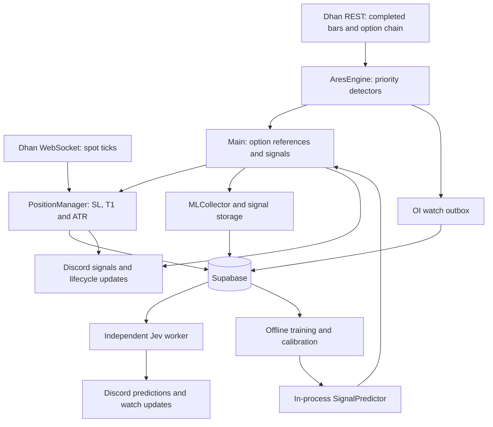

# ARES (Adaptive Reversal & Entry Signal) 🚀

<div align="center">


**Asynchronous NIFTY 50 spot-signal research, manual options references, and ML-assisted market analysis**

[Recent Updates](#recent-updates) • [Architecture](#architecture) • [Detection](#detection-strategies-and-confidence) • [Options](#option-pricing-and-lot-suggestions) • [Trade Tracking](#trade-tracking-and-post-t1-atr) • [Predictions](#machine-learning-and-jev-predictions) • [Setup](#setup-and-local-execution) • [Deployment](#deployment)

</div>

---

ARES evaluates completed one-minute NIFTY spot candles alongside open interest (OI), implied volatility (IV), and structural levels. It sends Discord signals, calculates option entry/SL/target references, and tracks the spot lifecycle in Supabase. XGBoost adds in-process probabilities; a separate TypeSafe Jev worker provides advisory assessments from persisted observations.

The current `main.py` signal path registers manual `SIGNAL_REFERENCE` trades. It submits no new paper or broker entry orders. Tracking continues independently of capital, suggested lots, or whether an option bracket is executable. Retained paper-execution APIs have separate observed-fill requirements, and new live order dispatch remains blocked.

## Recent Updates

This README describes the source in this checkout through **22 October 2026**. Earlier [changelog](CHANGELOG.md) entries preserve their implementation-time status; runtime rollout evidence must be checked separately.

| Update | Current behavior | Reference |
|---|---|---|
| Dhan WebSocket subscription | Sends the security ID as a string so the spot subscription can receive ticks for between-candle monitoring. | [PR #144](https://github.com/Manmade-Anyme/ARES/pull/144) |
| Manual signals and ATR runners | Tracks persisted signals independently of lots; after T1, completed five-minute spot closes govern the ATR runner. Fixed T2 remains a reference. | [PR #143](https://github.com/Manmade-Anyme/ARES/pull/143) |
| Uniform, compact Discord alerts | Shows available option entry, premium SL, T1/T2 and suggested lots without execution-status banners. Extra diagnostics default off. | [PR #142](https://github.com/Manmade-Anyme/ARES/pull/142), [PR #143](https://github.com/Manmade-Anyme/ARES/pull/143) |
| Capital-independent option prices | Calculates prices even with unavailable, zero, or insufficient capital; capital controls lots. The option R:R rejection has been removed. | [PR #141](https://github.com/Manmade-Anyme/ARES/pull/141), [PR #143](https://github.com/Manmade-Anyme/ARES/pull/143) |
| Completed-candle inputs | Evaluates each selected completed bar once, rebuilds full-session VWAP, and preserves risk monitoring on polls with no new candle. | [PR #140](https://github.com/Manmade-Anyme/ARES/pull/140), [input contract](docs/completed-candle-inputs.md) |
| Greeks-based option references | Uses current-expiry ATM-biased contract selection, Delta/Gamma projections, tick rounding, and nonnegative capped sizing. | [MANM-176](docs/MANM-176-options-entry-exit-sl-greeks-limit-orders.md) |
| Jev and ML reliability | Includes first-ready OI-wall assessments, shared-process supervision, confidence calibration, missing-data preservation, and audited training/promotion. TypeSafe SDK is constrained to `>=0.7.5,<0.8.0`; the default model remains `jev-1.13.0`. | [OI watch](docs/OI%20Wall%20Watch%20Jev.md), [SDK decision](directives/adr/TASK-258_update-jev-to-latest-version.md), [ML module](ml_signal/README.md) |

## Architecture



| Layer | Responsibility |
|---|---|
| Ingestion | `PriceFetcher` retrieves one-minute OHLCV and daily PDH/PDL; `OIFetcher` retains option quotes, OI, IV and Greeks; `TickFeed` supplies spot LTP between REST polls. |
| Orchestration and detection | `AresEngine` maintains rolling buffers, applies detector priority, setup geometry, confidence policy, R:R checks and cooldowns. |
| Manual trade tracking | `PositionManager` records spot references, monitors initial SL/T1, applies completed-bar ATR trailing, and restores persisted trade context. |
| Options and retained execution | `options_math.py` builds premium references and lot suggestions. `execution/` retains paper order monitoring and a tested broker adapter; main does not submit new entry orders. |
| Persistence | `storage.py` maintains signals, trades, analytics and prediction audits; `MLCollector` records evaluated market snapshots. Canonical UUIDs link records across schema modes. |
| Advisory predictions | XGBoost runs in-process. The independent `system_one` subprocess consumes saved signals and ready-watch observations for Jev assessments and durable delivery. |
| Analysis | `backtest/`, offline ML training, calibration and SHAP reports support research. GitHub Actions runs tests, training and deployment. |

### Completed candles and tick monitoring

- Detectors receive the **latest newly completed current-session one-minute bar**. Forming, duplicate, prior-session and invalid completed history do not advance strategy state. Selection is latest-only; missed historical bars are not replayed into detector buffers after restart.
- VWAP is rebuilt from all unique completed session bars returned by Dhan, including history before startup. Provider revisions replace earlier values rather than accumulating twice.
- Main acknowledges a selected candle immediately before engine handoff, after external prerequisites succeed. Duplicate/forming-only polls continue protective monitoring without generating another candle snapshot.
- WebSocket ticks support initial SL/T1 checks between REST polls. If the feed is inactive, no-new-candle polls request an independent fresh REST LTP. `TickFeed.is_active` indicates a feed object exists; it does not certify tick freshness.
- An already-running session may make one bounded final-bar attempt during 15:30–15:31 IST for the completed 15:29 bar. Protective checks remain active; any final signal candidate is analysis-only, with no entry alert, sizing, or new trade registration.

See the [completed-candle input contract](docs/completed-candle-inputs.md) for acknowledgment, close-crossing, fallback and shutdown details.

### Spot-based outcomes

Detection, setup geometry, trade labels and `pnl_points` use **NIFTY spot points**. Option premiums are derived references and estimates; they do not redefine spot outcomes. Manual tracking does not establish an option fill or realized account P&L.

Registered trades can carry across sessions without automatic end-of-day square-off. Initial stops remain until SL or T1; there is no timer-based break-even exit. Stored paper execution telemetry, where present, is separate from manual spot analytics.

## Detection Strategies and Confidence

The engine evaluates four detectors in short-circuit priority order. All signals remain subject to central setup geometry, R:R and cooldown checks. The startup-loaded calibration policy can downgrade an unsupported HIGH tier to MEDIUM; raw detector scores alone do not guarantee the emitted tier.

| Priority | Detector | Entry logic and scoring |
|---|---|---|
| 1 | Failed Breakout | Requires a close back inside a crossed structural level. Scores weak breakout volume, falling IV, active OI growth and a deep close-back. Minimum score is 2 of 4: raw MEDIUM at 2, HIGH at 3 or more. |
| 2 | OI Wall Rejection | Separates wall bias/persistence from entry. Requires interaction, a later favourable excursion, then a secondary retest on a later candle. A qualifying defended-side retest enters immediately on its close when bullish for PE support or bearish for CE resistance. Scores wall magnitude, OI growth, penetration and wick rejection; wick rejection is not a hard gate. |
| 3 | Trend Continuation | Establishes a VWAP/previous-day-level regime, then looks for a pullback and confirmed momentum resumption. Controlled by `continuation_enabled`. |
| 4 | Exhaustion Reversal | Requires volume climax and a doji-like small body after its history minimum. IV expansion, structural proximity and stronger volume/body conditions contribute to confidence. Raw HIGH requires at least two scored conditions. |

### OI-wall watches and cancellation

Both profiles enable the earlier `RETEST_READY` heads-up while waiting for a pullback. Failed direct watch delivery retries while the wall remains ready. Final OI-wall alerts include available retest time/close, original interaction and excursion telemetry. OI size and growth describe observations; they do not establish writer intent.

A delivered watch is cancelled when its setup expires, is replaced, breaches, fails R:R, or crosses into a new session. Successful final signal persistence and delivery resolve it. Failures retain guidance about any trade that may already be tracked. The durable Jev watch path adds producer-run fencing and recovery; the direct fallback retains process-local retry limits. See [watch cancellation](docs/oi-wall-watch-cancellation.md) and [OI-wall Jev assessment](docs/OI%20Wall%20Watch%20Jev.md).

The TASK-073 historical 18-trade replay gate was explicitly **skipped**, not passed. Unit and engine integration tests validate behavior; they do not establish profitability. The [replay remediation record](directives/adr/TASK-073_replay-evidence-remediation.md) preserves that scope.

### Setup geometry

`engine.apply_per_type_levels` applies the values in `config_profiles.py`. Both profiles currently share these spot-point defaults:

| Setup | Initial SL | T1 | T2 fallback |
|---|---:|---:|---:|
| `EXHAUSTION_REVERSAL` | 10 | 18 | 40 |
| `TREND_CONTINUATION` | 25 | 25 | 80 |
| `OI_WALL_REJECTION` | 16 | 25 | 40 |
| `FAILED_BREAKOUT` | 12 | 20 | 55 |

T1 is a fixed per-setup distance. T2 selects the nearest eligible structural level beyond T1, or uses its fallback. T2 is displayed for reference; current post-T1 runners exit through ATR trailing.

## Option Pricing and Lot Suggestions

`options_math.py` derives an option bracket from the spot signal and the full chain:

1. **Select a current-expiry contract:** Choose the correct CE/PE direction with complete quote/Greek inputs, absolute delta at least 0.45, and absolute delta closest to **0.50**. Preserve its broker security ID and expiry.
2. **Project premium levels:** Use signed Delta and Gamma with the selected quote's underlying spot as the projection base:

   ```text
   projected premium = reference premium + delta × spot change
                       + 0.5 × gamma × spot change²
   ```

   Entry limits account for the observed ask/slippage ceiling. Premium levels use ₹0.05 tick rounding and bracket-order validation. Theta/vega scenario helpers and expected-move diagnostics remain available; the former option theta/spread R:R rejection no longer gates prices or lots.
3. **Size separately from pricing:** Fetch Dhan available funds, clamp unavailable/nonpositive capital to zero, and calculate the risk and affordable lot counts. Final suggested allocation is nonnegative and capped by risk, affordability and `options_max_lots_cap`. Defaults are **4%** risk, **65** units per lot and a **10-lot** cap in `config_profiles.py`; these are repository settings, not a live contract-specification lookup. The conservative risk denominator includes linear delta loss and executable spread/entry uplift so theoretical gamma benefit cannot inflate allocation.
4. **Display manual references uniformly:** Available entry, SL, targets and lot suggestions remain visible even at zero lots or with an execution-ineligible bracket. Missing quote/Greek inputs are shown as unavailable. Option calculation or sizing failure does not suppress the spot signal's manual lifecycle.

The current calculator does not substitute `default_capital` for a failed funds request. Prices and Greeks are persisted in signal/trade context for later reporting. Compact Discord presentation is the default; `discord_show_option_details=True` enables extra diagnostics while console output remains detailed.

See [MANM-176 implementation and execution boundaries](docs/MANM-176-options-entry-exit-sl-greeks-limit-orders.md#7-implementation-contract-pr-136-and-pr-143-follow-up) for full pricing and retained paper-order contracts.

## Trade Tracking and Post-T1 ATR

| Phase | Current behavior |
|---|---|
| Registration | Persisted market-session signals register as manual `SIGNAL_REFERENCE` trades independently of capital/lots. Distinct nearby signals remain distinct; retries use a stable identity per canonical signal. |
| Before T1 | Monitor the initial per-setup spot SL and T1 using spot ticks and completed-candle high/low where applicable. |
| T1 | Mark `T1_HIT` and move the spot stop to entry. Spot analytics model a 50% T1 allocation; manual tracking makes no execution claim. |
| ATR warmup | Keep entry/the locked stop while valid completed five-minute inputs accumulate. Use Wilder ATR(5), HHV/LLV(10) and multiplier 2.5. Missing bars and session changes reset calculation windows. |
| Runner | Check each completed five-minute close against the **previously active stop before ratcheting**. Exit bullish/CE strictly below, bearish/PE strictly above. Equality and wicks do not exit a runner. Fixed T2 does not close it. |
| Persistence | Store state, stop, previous stop, ATR and processed-bar watermark. Restore persisted option/execution/ATR context on startup; legacy T1 trades without a watermark resume prospectively. |

The bullish candidate is `HHV(10) − 2.5 × ATR(5)`; the bearish candidate is `LLV(10) + 2.5 × ATR(5)`. Stops only tighten and retain the entry bound. A close-through exit uses the completed close, which can cross beyond the stop; the ratchet does not guarantee a fill at entry or at the stop.

`ATR_SL_UPDATED` alerts report a tightened stop. `ATR_SL_HIT` reports the runner's completed-close exit. Spot P&L for that exit is the mean of the signed entry-to-T1 and entry-to-close movements. Scores remain `SL_HIT=0`, `T1_HIT`/`ATR_SL_HIT=1`, with legacy `STOPPED_OUT_AT_BE=1` and `T2_HIT=2` retained for historical records.

Failed manual registrations retry on later market polls from a frozen original payload, followed by canonical ML linkage retries. This queue is process-local: it does not survive restart or reconstruct moves missed during an outage. Four-digit codes are for presentation; canonical signal/trade UUIDs provide durable linkage.

Retained paper APIs require an observed executable ask for entry and bid for exit. Paper ATR exit intent remains pending without a bid, and its initial emergency premium floor remains active. Application startup restores reporting context but does not reconstruct pending orders or resume paper simulation. `OrderManager` blocks new live dispatch with `LIVE_RUNTIME_UNSUPPORTED` before broker submission.

## Machine Learning and Jev Predictions

### In-process XGBoost

- `MLCollector` records technical, OI, IV, Greek, structural and detector context for evaluated candles, with `feature_version` metadata. Unobserved option data stays `NULL`/`NaN` rather than becoming fabricated zeroes.
- `SignalPredictor` loads the highest numbered model artifact and enriches live signals. Validated calibration artifacts control probability scaling and the fail-safe HIGH-to-MEDIUM gate.
- `PredictionLogger` asynchronously persists sanitized feature snapshots and signal/trade links to service-role-protected `ml_predictions`. Without service-role configuration, prediction audit persistence is disabled rather than attempted with an anon key.
- Offline training separates market-movement and trade-outcome pipelines, uses purged chronological walk-forward evaluation and promotion checks, and emits calibration, missingness and SHAP diagnostics. Training does not automatically make every candidate the production model.
- The Saturday workflow runs at **00:00 UTC / 05:30 IST**. It publishes metrics/artifacts and can post SHAP and an active-trading-day spot-P&L Sharpe diagnostic to Discord. That diagnostic is not a capital-return or after-cost Sharpe.

See [ML usage and offline reports](ml_signal/README.md), [calibration design](docs/MANM-157-confidence-calibration-design.md) and [data retention/privacy](docs/data_retention_and_privacy.md).

### Independent TypeSafe Jev worker

`system_one.consumer` polls persisted signal-bound snapshots for advisory T1/SL/T2 and market-context questions. Claims, freshness gates, archived results and Discord delivery state are durable; slow webhook delivery is separated from fresh inference. Jev does not generate entry orders or replace detector logic.

For the first `RETEST_READY` OI-wall watch, the worker can add a same-message closing-threshold probability, outlook, grounded evidence and assessment time from frozen first-ready context. Shared defaults in `OI_WATCH_JEV_CONFIG` are enabled, **25-point** minimum move, **8-second** wait and **60-second** maximum age. An unavailable assessment retains the base watch; this feature does not alter confirmed-trade questions or entry rules.

`scripts/run_app_with_jev.sh` starts main and Jev together, generates shared watch-run metadata, supervises Jev restarts, and stops the child worker when main exits. Standalone launches lack coordinated watch metadata and use the documented fallback. See [OI-wall Jev lifecycle and rollout](docs/OI%20Wall%20Watch%20Jev.md).

## Backtesting and Visualization

`backtest/` provides historical spot-candle simulation, performance reports and a TradingView PineScript v6 exporter. Simulation results describe the implemented replay model; they do not establish current live option execution or validate every manual/ATR runtime path.

## Project Structure

```text
ARES/
├── main.py                 # Session loop, signal persistence and manual registration
├── engine.py               # Detector priority, setup levels and quality gates
├── config.py               # Environment credentials and settings facade
├── config_profiles.py      # Expiry/non-expiry tuning and shared watch settings
├── models.py               # Candles, signals, quotes, Greeks and brackets
├── options_math.py         # Delta/Gamma references and lot suggestions
├── atr_trailing.py         # Completed 5m aggregation and Wilder ATR bands
├── position_manager.py     # Persistent manual spot lifecycle and ATR runner
├── alerts.py               # Discord signals, watches and lifecycle messages
├── storage.py              # Signal/trade persistence and prediction audits
├── fetchers/               # REST candles/chain/levels and WebSocket ticks
├── detectors/              # Four detectors, OI entry filter and expiry detection
├── execution/              # Retained paper/order APIs and documentation generator
├── ml_signal/              # Collection, inference, calibration and offline training
├── system_one/             # Independent Jev context, inference and delivery
├── oi_watch_outbox.py      # Durable ready-watch producer and lifecycle writes
├── oi_watch_context.py     # Watch candle provenance and frozen observations
├── backtest/               # Historical simulation and PineScript export
├── schema.sql              # Core database tables and bridge trade-entry RPC
├── migrations/             # Reviewed schema and lifecycle upgrades
├── scripts/run_app_with_jev.sh
├── docs/                   # Runtime contracts, implementation guides and research
├── tests/                  # Unit, integration and regression contracts
└── .github/workflows/      # CI/deploy, ML training and operational workflows
```

## Setup and Local Execution

### 1. Python environment

Use **Python 3.10** to match Docker and CI. Runtime dependencies include the Dhan SDK, Supabase client, pandas/NumPy, XGBoost `3.0.5` and TypeSafe SDK `>=0.7.5,<0.8.0`.

```bash
git clone https://github.com/Manmade-Anyme/ARES.git
cd ARES
python3.10 -m venv .venv
source .venv/bin/activate
python -m pip install -r requirements.txt
cp .env.example .env
```

### 2. Credentials and profiles

Populate `.env` from `.env.example`. Keep credentials outside source control.

| Variable | Type / default | Purpose |
|---|---|---|
| `DISCORD_WEBHOOK_URL` | String / empty | Signal, lifecycle and Jev/watch alert destination. |
| `DISCORD_HEALTH_WEBHOOK_URL` | Optional string / unset | Heartbeats and operational/error alerts. |
| `SUPABASE_URL` | String / empty | Database API URL; required for the engine and worker. |
| `SUPABASE_KEY` | String / empty | Main engine persistence and Dhan credential lookup; permissions must match the deployed policies. |
| `SUPABASE_SERVICE_ROLE_KEY` | String / empty | Required for Jev lifecycle tables/RPCs and ML prediction audit persistence. Backend only. |
| `TYPESAFE_API_KEY` | String / unset | Required for hosted Jev inference. |

Dhan credentials are loaded at startup from the existing Supabase `api_keys` row with `provider = 'DHAN'`, using its `client_id` and `access_token` fields. Provision that row through the existing credential-management process; adding Dhan variables to `.env` alone does not replace this lookup.

Edit trading parameters in **`config_profiles.py`**. Expiry detection selects `NON_EXPIRY_CONFIG` or `EXPIRY_CONFIG` at startup; ready-watch Jev settings are shared separately in `OI_WATCH_JEV_CONFIG`. The default asset settings in `config.py` are security ID `"13"` and exchange segment `IDX_I`. `TYPESAFE_MODEL` is an optional worker environment override; its default is `jev-1.13.0`.

### 3. Database provisioning

Use the maintained SQL files instead of copying a partial schema from this README:

| File | Purpose |
|---|---|
| [schema.sql](schema.sql) | Core signals, active trades, analytics, prediction audit schema and bridge trade-entry RPC. |
| [ml_signal/schema.sql](ml_signal/schema.sql) | ML collection and prediction tables. |
| [migrations/](migrations/) | Existing-install upgrades for canonical identity, timestamps, feature versions and lifecycle RPCs. Review prerequisites for the target database. |
| [TASK-210 migration](migrations/2026-10-01-task210-llm-predictions.sql) | Jev confirmed-signal jobs, predictions, delivery state and lifecycle RPCs. |
| [TASK-211 migration](migrations/2026-10-08-task211-oi-watch-jev.sql) | Ready-watch storage, producer fencing, recovery and delivery RPCs. |

For a new installation, start with the core and ML schemas, then review the upgrades required by the selected runtime. For an existing installation, apply the appropriate reviewed migrations rather than rerunning clean-install DDL. The default `signal_schema_mode` is **`bridge`**; the canonical-UUID cutover is a separate, guarded operation, not an instruction to bulk-run every migration.

The TASK-210 initial migration also requires a separately reviewed upgrade if an earlier version was already deployed. Jev and `ml_predictions` require backend service-role permissions. Preserve their service-role-only policies when provisioning access.

### 4. Run locally

For main plus the coordinated Jev worker, export credentials first: the worker reads environment variables directly and does not load `.env` itself. Local session clocks must use IST, matching Fly's `TZ` setting.

```bash
set -a
source .env
set +a
export TZ=Asia/Kolkata
sh scripts/run_app_with_jev.sh
```

To run only the signal engine:

```bash
TZ=Asia/Kolkata python main.py
```

Main loads `.env` through Pydantic settings. Without the shared launcher metadata, ready-watch delivery follows the direct fallback described above.

### 5. Tests and useful commands

```bash
python -m pip install -r requirements-dev.txt
python -m pytest tests/ -q
python -m pytest tests/ --cov=. --cov-branch --cov-report=term-missing
```

Use `python -m pytest` from the repository root, as CI does. Test totals change with the suite; the linked CI workflow is the source for current results.

| Command | Purpose |
|---|---|
| `python main.py` | Main signal engine with manual reference tracking; use an IST process clock. |
| `sh scripts/run_app_with_jev.sh` | Main plus supervised Jev with shared watch-run identity; export `.env` first. |
| `python -m system_one.consumer` | Standalone confirmed-signal Jev worker; lacks coordinated ready-watch metadata. |
| `python -m ml_signal.train_offline --help` | Offline training and promotion options; see ML dependency/setup instructions before training. |
| `python -m ml_signal.backfill_labels` | Preview historical label/P&L reconciliation; report-only by default, reading `.env`. |

CI additionally enforces 100% statement/branch coverage for `system_one` and executes isolated ready-watch SQL lifecycle and PostgreSQL concurrency checks. These are specific gates, not a claim of whole-repository 100% coverage.

## Deployment

`fly.toml` configures one scheduled **1 GB shared-CPU `app` Machine in Singapore (`sin`)**, running `sh scripts/run_app_with_jev.sh`. Main and Jev share that Machine and its weekday start/stop schedule. There is no HTTP service; the configured restart policy is `never`, while the launcher supervises the Jev child during the app lifetime.

Provision runtime credentials on Fly, including the backend service-role and TypeSafe keys for Jev, and apply reviewed database migrations before enabling their features. Fly runtime secrets and GitHub Actions secrets are separate stores.

The [deploy workflow](.github/workflows/deploy.yml) runs tests on PRs and `main`, then permits deployment only from `main`. It uses a runner-local Docker build and retries selected transient Fly deployment failures. Routine deployments should be scheduled outside market hours: restarting clears detector warmup state, although the next successful fetch rebuilds VWAP from session history.

The [weekly ML workflow](.github/workflows/ml_training.yml) performs audited training and publishes promoted artifacts and associated reports. See [DEPLOYMENT.md](DEPLOYMENT.md) for bootstrap, secret stores and scheduler operations.

## Operational Bounds

| Setting | Current default / behavior |
|---|---|
| Active market session | **09:15–15:30 IST**, with the bounded final-bar analysis described above. |
| REST cadence | **60 seconds**; tick monitoring continues between polls. |
| Candle history | Rolling buffer capacity is **30 fresh completed candles**. Readiness is detector-specific; there is no universal 30-bar entry gate. Startup history rebuilds VWAP but is not replayed into this buffer. |
| Signal cooldown | **15 minutes** non-expiry / **20 minutes** expiry, across emitted signals; an initial SL exit clears the cooldown. |
| ATR runner | Completed **5m** spot bars, Wilder **ATR(5)**, **HHV/LLV(10)**, multiplier **2.5**. |
| Session carry | Registered trades persist across sessions; ATR inputs reset for a new session while the locked stop remains. |
| Configuration | Trading thresholds in `config_profiles.py`; credentials in `.env` or backend environment secrets. |

## Disclaimer

ARES supports quantitative research and manual trading decisions. Option prices and model probabilities are estimates, and manual signal tracking does not record actual broker execution. Validate behavior and risk before using signals with real capital.
