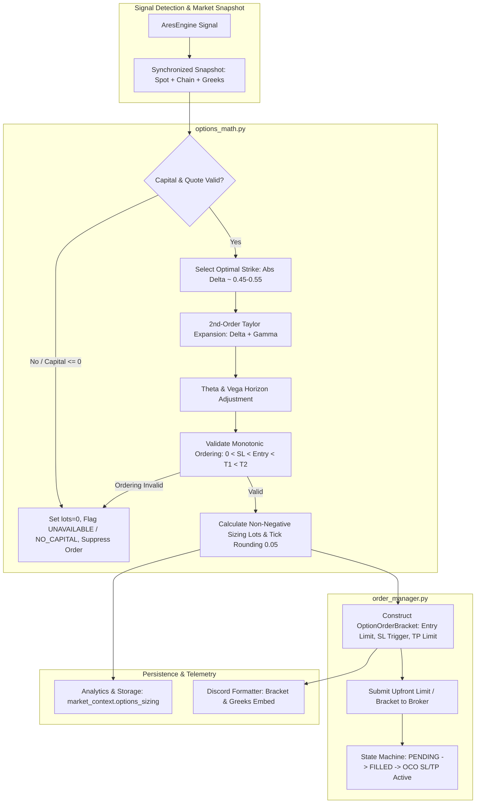

# ADR-176: Improve Options Entry, Exit, and SL Calculations Using Greeks and Limit Orders

- **Status**: Proposed
- **Date**: 2026-10-15
- **Task ID**: MANM-176
- **Author**: Software Architect Agent
- **Target Branch**: `feature/MANM-176-options-entry-exit-sl`

---

## 1. Problem Statement and Root Cause

### 1.1 Linear Delta-Only Premium Distortion
In the current ARES options calculation layer (`options_math.py:13-14` and `options_math.py:125-127`), premium translation from underlying NIFTY spot points to option premium is strictly linear:
$$\text{opt\_sl\_pts} = \text{index\_sl\_pts} \times |\Delta|$$
$$\text{opt\_tp\_pts} = \text{index\_tp\_pts} \times |\Delta|$$

Option contracts are fundamentally non-linear derivatives whose price changes with respect to the underlying spot are governed by second-order curvature (Gamma, $\Gamma$), time decay (Theta, $\Theta$), and implied volatility shifts (Vega, $\mathcal{V}$).
- Over index movements of 15 to 40 spot points (the standard SL and T1/T2 distances in `config_profiles.py`), ignoring Gamma systematically under-projects target reward for winning long options and miscalculates premium drawdown at stop loss.
- Intraday time decay ($\Theta$) accelerates significantly on expiry days (0 DTE) and near-term contracts, yet no time-horizon or volatility decay discount is applied.

### 1.2 Fabricated Quotes and Inverted Order Levels
When Dhan option chain data lacks `delta` or `ltp` for a candidate strike, `options_math.py:98-112` currently falls back to synthetic sentinel values: `delta = 0.50` (or `-0.50`) and `LTP = 100.0`. These fabricated numbers are treated as real quotes, resulting in phantom sizing and misleading alerts.
Furthermore, applying an arbitrary Rs 1.0 floor via `opt_sl_price = max(1.0, ltp - opt_sl_pts)` causes critical price inversion whenever $LTP < \text{opt\_sl\_pts}$: a contract trading at Rs 0.50 with a 4-point SL produces an option stop loss of Rs 1.0 (above the entry price).

### 1.3 Negative Available Capital & Inverted Lot Sizing (Production Audit Defect)
As documented in the 2026-09-22 and 2026-09-23 production audits on MANM-176 (35 historical occurrences):
- `fetch_dhan_capital()` returns negative balance if the trading account balance is in debit (e.g., `-₹39.19`).
- `calculate_risk_amount()` propagates the negative rupee amount.
- `calculate_lots()` and `calculate_affordable_lots()` both invoke `math.floor()`, converting `-39.19 / (sl_points * lot_size)` into `-1` suggested lot.
- Downstream downstream reporting multiplies by `-1`, inverting P&L attribution and corrupting analytics tables.

### 1.4 Execution Gap: Reactive Market Orders vs Upfront Limit & Bracket Orders
ARES currently relies on simulated or reactive spot-level triggers. When trading actual option contracts, sending unconstrained market orders incurs severe slippage on NIFTY options (often 2 to 5 premium points in fast markets). Furthermore, placing stop loss and target orders reactively after fill confirmation creates dangerous execution latency. Upfront Limit Orders with predetermined Bracket levels (Entry Limit, Contingent SL Trigger, and Target Limit) are required before order placement.

---

## 2. Decision and Architecture Overview

We decouple and upgrade the options calculation and execution pipeline into three robust architectural pillars:
1. **Greeks-Based Second-Order Taylor & Scenario Pricing Engine** (`options_math.py`).
2. **Strict Quote Validation, Capital Hard-Borders, and Monotonic Level Verification**.
3. **Upfront Bracket Order Specification & Execution State Machine** (`models.py`, `order_manager.py`).



---

## 3. Mathematical Specifications

### 3.1 Second-Order Taylor Premium Projection
For a long option (Call or Put) with current entry reference price $P_0$ at underlying index spot $S_0$:
$$P(S) \approx P_0 + \Delta \cdot (S - S_0) + \frac{1}{2} \Gamma \cdot (S - S_0)^2$$

Where:
- For Calls: $\Delta > 0, \Gamma > 0$. When spot rises to target ($S > S_0$), $\Delta (S - S_0) > 0$ and $\frac{1}{2}\Gamma (S - S_0)^2 > 0$.
- For Puts: $\Delta < 0, \Gamma > 0$. When spot falls to target ($S < S_0$), $\Delta (S - S_0) > 0$ (favorable gain) and $\frac{1}{2}\Gamma (S - S_0)^2 > 0$ (positive convexity).
- At Spot Stop Loss ($S_{SL}$): The adverse spot move $(S_{SL} - S_0)$ produces a negative first-order delta component. The positive gamma term reduces the theoretical instantaneous loss. However, for risk-sizing conservatism, **loss sizing must use the linear delta loss as an upper-bound risk floor** to prevent over-sizing positions based on curvature benefit:
$$\text{RiskLossPts} = \max\left(P_0 - P(S_{SL}),\ |\Delta| \cdot |S_0 - S_{SL}|\right)$$

### 3.2 Time Decay ($\Theta$) and Volatility ($\mathcal{V}$) Scenario Offsets
Let $\Delta t$ be the expected holding horizon in trading days (default intraday scalp horizon: $\Delta t = \frac{15\text{ min}}{375\text{ min}} \approx 0.04$ day):
$$P_{\text{projected}}(S, \Delta t, \Delta \sigma) = P_0 + \Delta \cdot (S - S_0) + \frac{1}{2}\Gamma \cdot (S - S_0)^2 + \Theta \cdot \Delta t + \mathcal{V} \cdot \Delta \sigma$$
- For instantaneous bracket submission (immediate entry/SL/TP limits), $\Delta t = 0$ and $\Delta \sigma = 0$ are used as the base executable bracket.
- For target feasibility evaluation, $P_{\text{projected}}(S_{T1}, \Delta t_{\text{expected}}, 0)$ must yield a net risk-to-reward $R \ge 1.0$ after adverse spread allowances.

### 3.3 Strict Risk Sizing & Capital Hard-Borders
Let $C$ be the available balance returned from DhanHQ, and $r$ the configured risk fraction (`risk_per_trade_pct / 100.0`):
1. **Capital Validity**: If $C \le 0$ or balance fetch fails without verified fallback, set `suggested_lots = 0`, `affordable_lots = 0`, attach reason `NO_AVAILABLE_CAPITAL`, and abort execution.
2. **Sizing Math**:
   $$B = C \times r$$
   $$\text{PerLotLoss} = \text{RiskLossPts} \times \text{lot\_size}$$
   $$\text{suggested\_lots} = \begin{cases} \lfloor \frac{B}{\text{PerLotLoss}} \rfloor & \text{if } \text{PerLotLoss} > 0 \text{ and } C > 0 \\ 0 & \text{otherwise} \end{cases}$$
   $$\text{affordable\_lots} = \begin{cases} \lfloor \frac{C}{P_{\text{entry}} \times \text{lot\_size}} \rfloor & \text{if } P_{\text{entry}} > 0 \text{ and } C > 0 \\ 0 & \text{otherwise} \end{cases}$$
   $$\text{final\_lots} = \max(0, \min(\text{suggested\_lots}, \text{affordable\_lots}, \text{max\_lots\_cap}))$$
3. Guaranteed Invariant: $\text{final\_lots} \ge 0$ under all inputs.

### 3.4 Monotonic Level Invariants & Tick Rounding
Every option price level must be rounded to the nearest valid exchange tick ($0.05$ for NSE options):
$$\text{round\_tick}(p) = \text{round}(p / 0.05) \times 0.05$$
For a long option contract, the executable levels must strictly satisfy:
$$0.05 \le \text{option\_sl} < \text{entry\_limit} < \text{option\_t1} < \text{option\_t2}$$
If this ordering fails (e.g. entry premium too low, or SL projected $\le 0$), the bracket is rejected with `INVALID_BRACKET_ORDERING`.

---

## 4. Upfront Limit and Bracket Order Architecture

### 4.1 Entry Limit Price Construction
Rather than sending unrestricted market orders, the entry limit price is calculated at signal confirmation:
$$P_{\text{limit\_entry}} = \min\left(\text{BestAsk},\ \text{LTP} + \text{slippage\_buffer}\right)$$
Where `slippage_buffer` is configured (default: 0.50 points). If Best Ask is unavailable, $LTP + \text{slippage\_buffer}$ is used.

### 4.2 Upfront Bracket State Machine
```text
[Signal Triggered] 
       │
       ▼
[Calculate Greeks & Bracket Levels]
       │
       ├── (Invalid / Lots=0) ──► [TELEMETRY: Execution Suppressed]
       │
       ▼ (Valid, Lots > 0)
[Place Upfront Entry Limit Order] ──► STATE: PENDING_ENTRY
       │
       ├── (Fill Timeout / Expiry) ──► [Cancel Order] ──► STATE: CANCELLED
       │
       ▼ (Order Filled at P_fill)
[Register Contingent OCO Bracket] ──► STATE: IN_POSITION
       ├── Option SL Trigger: P_sl
       └── Option TP1 Limit: P_tp
       │
       ├── (SL Triggered) ──► [Cancel TP Limit] ──► STATE: CLOSED_SL
       └── (TP Hit)       ──► [Cancel SL Trigger] ──► STATE: CLOSED_TP
```

---

## 5. Component Boundaries and File Assignments

### 5.1 `models.py`
Add explicit typing contracts:
```python
@dataclass
class OptionGreeks:
    delta: float
    gamma: float
    theta: float
    vega: float
    iv: float

@dataclass
class OptionOrderBracket:
    strike: int
    option_type: Literal["CE", "PE"]
    entry_limit: float
    stop_loss: float
    target_1: float
    target_2: Optional[float]
    lots: int
    greeks: OptionGreeks
    is_valid: bool
    rejection_reason: Optional[str] = None

# AresSignal extensions
@dataclass
class AresSignal:
    # Existing fields...
    bracket: Optional[OptionOrderBracket] = None
    options_sizing_status: str = "PENDING"  # "VALID", "NO_AVAILABLE_CAPITAL", "INVALID_DATA"
```

### 5.2 `fetchers/oi_fetcher.py`
- Update `fetch_chain()` to extract `delta`, `gamma`, `theta`, `vega`, and `iv` for all strikes across the full option chain table, rather than only populating them on the ATM row.
- Carry `ce_gamma`, `pe_gamma`, `ce_theta`, `pe_theta`, `ce_vega`, `pe_vega` into each row of `full_chain`.

### 5.3 `options_math.py`
Refactor existing linear functions into a pure, comprehensive calculation suite:
- `calculate_risk_amount(capital: float, risk_pct: float) -> float`: Clamps negative capital to 0.0.
- `calculate_greek_premium_translation(spot_delta: float, delta: float, gamma: float) -> float`: Implements the 2nd-order Taylor projection.
- `round_to_tick(price: float, tick_size: float = 0.05) -> float`: Exchange tick rounding.
- `validate_capital(capital: Optional[float]) -> Tuple[float, bool]`: Returns validated non-negative balance and validity flag.
- `calculate_lots(risk_amt: float, sl_points: float, lot_size: int) -> int`: Returns $\ge 0$ integer, returns 0 if inputs $\le 0$.
- `calculate_affordable_lots(capital: float, premium: float, lot_size: int) -> int`: Returns $\ge 0$ integer.
- `build_option_bracket(signal: AresSignal, full_chain: list, capital: float, config: TuningConfig) -> OptionOrderBracket`: Pure constructor for executable bracket.
- `process_options_calculation(...)`: Orchestrates strike selection, Greek calculation, bracket construction, and signal attachment without fabricating sentinel quotes.

### 5.4 `execution/order_manager.py` (New / Refactored Module)
- Define `OrderManager` to handle Dhan limit order dispatch and contingent OCO bracket management.
- Pure order state machine supporting simulated execution and live Dhan API integration.

### 5.5 `storage.py` and `reports.py`
- Persist `market_context.options_sizing` containing `greeks` (`delta`, `gamma`, `theta`, `vega`), `entry_limit`, `option_sl`, `option_target`, `capital`, and `rejection_reason`.
- Enforce non-negative lot guard in `reports._option_rupees()` to prevent sign inversion on legacy dirty rows.

### 5.6 `alerts.py`
- Update `format_signal` Discord embed to present Greeks ($\Delta, \Gamma, \Theta, \mathcal{V}$), entry limit, bracket SL/TP, and validated lot allocation.

---

## 6. Alternatives Considered

1. **Full Black-Scholes Repricing on Every Tick**:
   - *Rejected*: Re-evaluating numerical Black-Scholes / Bjerksund-Stensland for every strike on live websocket ticks introduces CPU latency and relies heavily on accurate real-time risk-free rate and dividend yield assumptions. Second-order Taylor expansion provides >98% accuracy over typical intraday NIFTY spot moves (15–40 pts) with microsecond latency.
2. **Market Orders with Post-Fill Reactive Stop Placement**:
   - *Rejected*: Suffers from exchange execution delay and bid-ask spread slippage (often 2–5% of option premium). Upfront limit orders guarantee price caps.
3. **Retaining LTP = 100 / Delta = 0.50 Fallbacks**:
   - *Rejected*: Fabricated data violates system audit invariants and caused production issues. Missing market data must fail closed and suppress execution.

---

## 7. Definition of Done & Verification Checklist

- [ ] **Pure Greek Calculation Tests**: Verify 2nd-order Taylor expansion for Call and Put across positive and negative spot movements in `tests/unit/test_options_math.py`.
- [ ] **Capital Boundary Regressions**: Test negative capital (`-39.19`), zero capital (`0.0`), and null capital, proving `suggested_lots == 0` and no negative lots are produced.
- [ ] **Quote Validity & Missing Data**: Verify that missing Greeks or LTP marks the bracket as invalid and does not inject fake quotes (LTP 100 / Delta 0.5).
- [ ] **Bracket Ordering Verification**: Test that inverted levels ($SL \ge \text{Entry}$) are caught and flagged with `INVALID_BRACKET_ORDERING`.
- [ ] **Tick Rounding**: Ensure all computed prices are exact multiples of 0.05.
- [ ] **Full Chain Greeks Verification**: Unit tests verifying `fetch_chain` returns full Greeks for all strikes.
- [ ] **Reporting Invariant**: Verify `reports._option_rupees()` never inverts P&L on negative lot inputs.
- [ ] **Pre-commit Doc Sync**: Sync ADR to repository docs and Obsidian vault.
