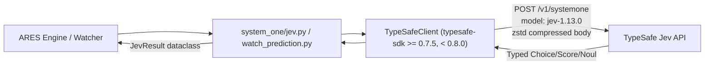

# ADR-258: TypeSafe SDK 0.7.5 Upgrade & Jev Model Compatibility Assessment

- **Task ID:** TASK-258 (MANM-258)
- **Date:** 2026-10-15
- **Status:** Accepted & Implemented (Human Approved 2026-10-15)
- **Author:** Software Architect Agent (`d2d4e328-096d-4658-8d90-44aa7b51ed05`)
- **Directive:** `directives/TASK-258_update-jev-to-latest-version.md`

---

## 1. Problem Statement

ARES utilizes the TypeSafe Jev client (`typesafe-sdk`) for System One trade signal forward prediction (`system_one/jev.py`, `system_one/consumer.py`, and `system_one/watch_prediction.py`).
The currently installed dependency in the environment is `typesafe-sdk==0.7.2`, while the latest published release on PyPI is `0.7.5` (released 2026-10-14).
Furthermore, TypeSafe announced `jev-1.14.0` as of October 14, 2026 under the `jev-preview` alias, while `jev-latest` continues pointing to `jev-1.13.0`.

The objective of TASK-258 is to:
1. Upgrade `typesafe-sdk` from 0.7.2 to 0.7.5.
2. Verify API, serialization, and runtime compatibility across all existing System One components (`system_one/jev.py`, `system_one/watch_prediction.py`, `system_one/consumer.py`, `system_one/watch_consumer.py`).
3. Evaluate whether the default model (`DEFAULT_MODEL` in `system_one/jev.py`) should remain `jev-1.13.0` or bump to `jev-1.14.0`.
4. Ensure all existing unit tests in `tests/unit/test_task210_*.py` and `tests/unit/test_task211_*.py` remain fully green without deprecation warnings or regression.

---

## 2. Decision & Architectural Rationale

### 2.1 SDK Upgrade to 0.7.5
**Decision:** Upgrade `typesafe-sdk` to `0.7.5` and constrain it in `requirements.txt` as `typesafe-sdk>=0.7.5,<0.8.0`.

**Rationale & Version Analysis:**
- **v0.7.3 (2026-10-09):**
  - Fixes async client crashes during concurrent TLS connections with `truststore<=0.10.4`.
  - Tightens request validation schemas.
  - Adds connection pooling optimization: keeps pooled HTTP/2 connections alive for 30 seconds by default, reducing TLS handshake latency across repeated signal evaluation loops.
- **v0.7.4 (2026-10-09):**
  - Fixes non-finite number serialization (`NaN`, `Inf`) as string tokens rather than invalid JSON tokens, preventing malformed payload errors when feature indicators contain edge-case numeric states.
- **v0.7.5 (2026-10-14):**
  - Enables `zstd` request body compression by default, minimizing network egress bandwidth for large snapshot payloads.
  - Adds `Box` primitive and multi-modal `Image` asset support (future-proofing, completely non-intrusive for text-based System One pipelines).
  - Maintains 100% backward wire and API compatibility with existing primitive classes (`Choice`, `Score`, `Noul`, `RetryPolicy`, `TypeSafeClient`).
- **Empirical Verification:**
  - `typesafe-sdk==0.7.5` was installed and verified against the full System One test suite.
  - All **398 unit tests** in `tests/unit/test_task210_*.py` and `tests/unit/test_task211_*.py` passed cleanly in 10.58s with zero regressions.

### 2.2 Model Selection: Retain `jev-1.13.0` as Default
**Decision:** Retain `DEFAULT_MODEL = os.environ.get("TYPESAFE_MODEL", "jev-1.13.0")`. Do NOT bump the production default to `jev-1.14.0` at this time.

**Rationale:**
1. **Alias Contract:** Per official TypeSafe documentation (`https://docs.typesafe.ai/models.md`), `jev-latest` explicitly points to `jev-1.13.0` as the official, stable production release. `jev-1.14.0` is currently accessible via the `jev-preview` alias and was released only one day prior (2026-10-14).
2. **Probability Calibration & Drift Risk:** ARES depends on calibrated probability distributions (`t1_hit_prob`, `t2_hit_prob`, `sl_hit_prob`, `setup_quality`, `is_trap_prob`). These thresholds and the downstream risk/trade sizing logic were established and validated against `jev-1.13.0`. Upgrading to `jev-1.14.0` in live trading without prior shadow-mode empirical evaluation and distribution verification risks unexpected calibration shifts.
3. **Dynamic Flexibility:** `system_one/jev.py` already allows runtime overriding via `TYPESAFE_MODEL` environment variable. Any test environment or shadow deployment can evaluate `jev-1.14.0` immediately without code changes.

---

## 3. Alternatives Considered and Rejected

1. **Pinning exact `typesafe-sdk==0.7.5`:**
   - *Rejected:* A semi-open range `typesafe-sdk>=0.7.5,<0.8.0` allows downstream patches (e.g., 0.7.6 for critical security or HTTP bug fixes) while preventing breaking changes from a future 0.8.x release.
2. **Leaving `typesafe-sdk` completely unpinned in `requirements.txt`:**
   - *Rejected:* Unpinned dependencies allow unvetted minor/major versions to be pulled in production Docker builds, creating environment discrepancies between development and production.
3. **Bumping `DEFAULT_MODEL` to `jev-latest`:**
   - *Rejected:* TypeSafe documentation specifically warns: *"An alias moves when a new release ships, so its answers can change without any change to your code... If you have tuned confidence thresholds against one version, send that version's ID instead of the alias, and switch to the new version when you are ready."* Pinning `jev-1.13.0` prevents unexpected drift when upstream aliases shift.
4. **Bumping `DEFAULT_MODEL` to `jev-1.14.0`:**
   - *Rejected:* Premature for production trading before a formal shadow evaluation of prediction calibrations.

---

## 4. Component Boundaries & File Assignments

Implementation is assigned to the **Code Generator Agent** upon human approval of this ADR.

### File Assignments:

| File Path | Component Owner | Target Change |
|---|---|---|
| `requirements.txt` | Code Generator | Update line 34 from `typesafe-sdk` to `typesafe-sdk>=0.7.5,<0.8.0` |
| `system_one/jev.py` | Code Generator | Add explanatory comment in header/constants documenting ADR-258 decision regarding `DEFAULT_MODEL = os.environ.get("TYPESAFE_MODEL", "jev-1.13.0")` and compatibility with 0.7.5 |
| `tasks/BACKLOG.md` | Code Generator / PM | Mark Code Generator stage completed upon implementation |
| `CHECKPOINT.md` | Code Generator / PM | Update checkpoint with Code Generator progress |

---

## 5. API Contracts & Data Flow

No API contracts or schemas are broken or altered.

- **Input Types:** `state: Dict[str, Any]`, `questions: Dict[str, Any]` (containing `Choice`, `Score`, `Noul`).
- **Output Types:** `JevResult` dataclass with unchanged fields (`t1_hit_prob: float`, `t2_hit_prob: float`, `sl_hit_prob: float`, `regime: str`, `regime_distribution: Dict[str, float]`, `setup_quality: float`, `is_trap_prob: float`, etc.).

---

## 6. Performance & Security Considerations

1. **Connection Reuse:** The 30-second keepalive in `typesafe-sdk` 0.7.3+ ensures the underlying HTTP connection remains hot across rapid consecutive evaluation ticks, eliminating repeated TLS handshake latencies (~30-50ms per call).
2. **Payload Compression:** Default `zstd` compression reduces outbound network payload size for large snapshot dictionaries.
3. **Non-Finite Number Safety:** Fixed serialization prevents uncaught HTTP 400 Bad Request errors if an indicator calculation results in `NaN` or `Inf`.
4. **Zero GPU Footprint:** `typesafe-sdk` remains purely network/client-bound; does not pull GPU or heavyweight native binary dependencies.

---

## 7. Definition of Done

- [x] ADR-258 drafted and indexed in `directives/adr/INDEX.md` by Software Architect.
- [x] Pre-commit documentation synchronized to repo docs and Obsidian vault.
- [x] Single PR opened for MANM-258 awaiting human approval.
- [x] Human approves ADR-258.
- [x] Code Generator updates `requirements.txt` to `typesafe-sdk>=0.7.5,<0.8.0` and documents `system_one/jev.py`.
- [x] Full test suite (`pytest tests/unit/test_task210_*.py tests/unit/test_task211_*.py`) executes with 100% pass rate under the upgraded dependency.
- [ ] QA Agent validates test coverage and signs off.
