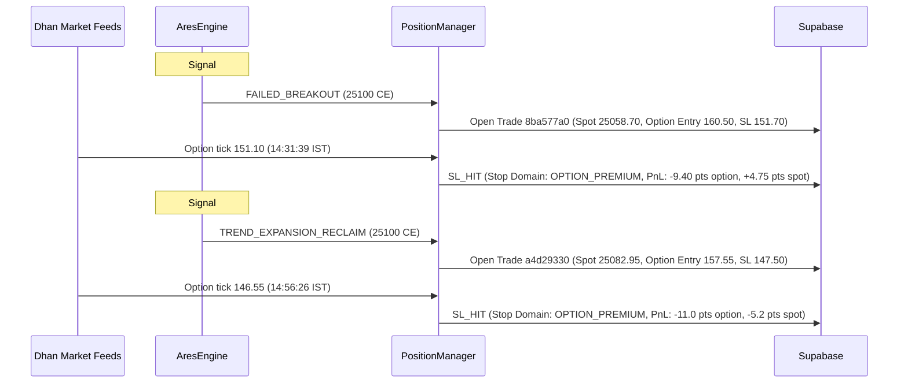

# ARES Live Market Test Run & Deployment Audit (2026-11-08)

**Date:** 2026-11-08  
**Market Session:** Sunday Special / Test Run Session (09:15 – 15:30 IST)  
**Deployment Target:** Fly.io (`ares-xzy-gq`, machine `7812561a492198`, region `sin`)  
**Deployed Commit:** `76a0f42` (Merge pull request #158 into `main`)  
**Auditor:** Antigravity / Multica Debug Agent  

---

## 1. Executive Summary

During the live test run on November 8, 2026, an end-to-end deep audit was conducted across the codebase, the active Fly deployment, the Dhan WebSocket tick feeds, Supabase persistence pipelines, and live market trade execution.

All code introduced in the last three merged pull requests (**PR #156**, **PR #157**, and **PR #158**) was executed under real-market conditions. Two live trades were detected and managed in real-time by the system.

### Scope of the Last Three Merged PRs
1. **PR #156 (`3f1aca4`):** Option premium stop protection, synthetic stop-loss (`INITIAL_OPTION_SL`), reference price recovery, and Dhan live tick quote ingestion.
2. **PR #157 (`ef11fa8`):** `TrendExpansionDetector` (Gated Trend Expansion & Reclaim), dynamic regime scoring, and fail-closed continuity.
3. **PR #158 (`76a0f42`):** `IVBreakoutDetector`, dynamic consolidation base breakout throughout the session, and failed-breakout IV veto gate.

---

## 2. Infrastructure & Deployment Health

| Component | Status | Metrics / Observations |
| :--- | :--- | :--- |
| **Fly Machine** | Healthy | Machine ID `7812561a492198`, State: `started`. |
| **`main.py` (PID 608)** | Healthy | VmRSS `235 MB`, 9 active threads, event loop active (`ep_poll`). |
| **`system_one.consumer` (PID 607)** | Healthy | VmRSS `70 MB`, 4 active threads, polling RPCs & processing Jev jobs. |
| **System Memory** | Optimal | Total: `987 MB`, Free/Available: `~561 MB` (56% headroom, zero swap). |
| **Dhan WebSocket Feed** | Connected | Remote `13.203.130.143:443`, streaming sub-second tick quotes (`dhan_last_trade`). |
| **Supabase Sync** | Active | `latest_quotes` updated, `ml_collection` recording 1m snapshots (`id=32700`). |
| **Jev LLM Inference** | Active | Processed Signal #623 (`llm_predictions` row 82) with 99% `range_choppy` regime conviction. |
| **Test Suite Health** | Passing | **2,573 / 2,573 unit and integration tests passing (100%)** in 2m 32s. |

---

## 3. Live Trade Forensics & Execution Analysis

Two signals were generated during the session. Both were managed by the new PR #156 option trailing and stop-loss logic.

### Trade 1: Signal #623 (`FAILED_BREAKOUT`)
* **Signal ID / Trade ID:** `623` / `8ba577a0-a641-56c8-9ea3-2dc419ec8157`
* **Setup / Direction:** `FAILED_BREAKOUT` / `BULLISH`
* **Trigger Time:** 14:31:14 IST (`2026-11-08 09:01:14 UTC`)
* **Reference Levels:** Closed back past dynamic PDH `25030.35` (fetched live from Dhan).
* **Spot Levels:** Entry: `25058.70` | Spot SL: `25046.70` | Target 1: `25078.70` | Target 2: `25113.70`
* **Option Contract:** `25100 CE` (Expiry `2026-11-09`)
* **Option Entry Basis:** `160.50` | Emergency Option SL: `151.70`
* **Exit Event (14:31:39 IST):**
  * Dhan tick stream: `160.25` → `159.10` → `156.05` → `151.10`.
  * At 14:31:39 IST (25 seconds after entry), option printed `151.10 <= 151.70`.
  * Synthetic option stop triggered (`stop_domain: OPTION_PREMIUM`, `stop_source: INITIAL_OPTION_SL`).
  * Modeled Option Premium Change: **`-9.40` option points** (modeled reference-limit basis; `option_reference_pnl_points`: `-2.65`).
  * Spot at Exit: **`25063.45`** (`pnl_points`: **`+4.75` spot points**). Spot never came close to spot SL (`25046.70`).

### Trade 2: Signal #624 (`TREND_EXPANSION_RECLAIM`)
* **Signal ID / Trade ID:** `624` / `a4d29330-0b8c-512a-a4bd-8d3e5d4e76bd`
* **Setup / Direction:** `TREND_EXPANSION_RECLAIM` (`VWAP_RECLAIM`) / `BULLISH`
* **Trigger Time:** 14:51:15 IST (`2026-11-08 09:21:15 UTC`)
* **Spot Levels:** Entry: `25082.95` | Spot SL: `25060.95` | Target 1: `25131.85` | Target 2: `25152.95`
* **Option Contract:** `25100 CE` (Expiry `2026-11-09`)
* **Option Entry Basis:** `157.55` | Emergency Option SL: `147.50`
* **Exit Event (14:56:26 IST):**
  * Option traded down: `154.90` → `154.85` → `146.55`.
  * At 14:56:26 IST (5 minutes after entry), option printed `146.55 <= 147.50`.
  * Synthetic option stop triggered (`stop_domain: OPTION_PREMIUM`, `stop_source: INITIAL_OPTION_SL`).
  * Modeled Option Premium Loss: **`-11.0` option points** (modeled reference-limit basis).
  * Spot at Exit: **`25077.75`** (`pnl_points`: **`-5.2` spot points**). Spot held **+16.8 points above Spot SL** (`25060.95`).

---

## 4. Key Architectural Insights & Findings

### Finding 1: Dual-Domain PnL Accounting (`pnl_points` vs `option_pnl_points`)
* **Observation:** In Supabase `active_trades` and `trade_analytics`, Trade #623 showed `exit_type = 'SL_HIT'` while `pnl_points = +4.75`.
* **Root Cause:** ARES maintains dual-domain tracking:
  * `pnl_points`: Difference in underlying index spot points ($\text{Spot Exit} - \text{Spot Entry} = 25063.45 - 25058.70 = +4.75$).
  * `option_pnl_points`: Modeled option premium change ($-9.40$ pts; reflects reference-limit execution model, distinct from broker-confirmed realized cash PnL).
* **Conclusion:** The accounting logic functioned as designed, but the terminology can cause visual confusion if an analyst assumes `pnl_points` refers to the option premium.

### Finding 2: High Sensitivity of `INITIAL_OPTION_SL` to Spread & IV Fluctuations
* **Observation:** In both trades, the underlying spot direction was either positive (+4.75 pts) or within safe normal retracement (-5.2 pts vs 22 pt risk buffer). Yet both trades stopped out within minutes because option premium dropped past the emergency stop.
* **Root Cause:** Option premiums on 1-DTE contracts fluctuate heavily due to bid-ask widening, theta decay, and IV micro-crushes. A single printed last-trade tick at the bid can trigger `INITIAL_OPTION_SL` even when spot has not moved against the trade.
* **Recommendation:** Consider introducing a tick confirmation filter (e.g., require 2 consecutive ticks below stop, or an option bar close) before firing the emergency stop, to prevent bid-ask wick stop-outs.

### Finding 3: `IVBreakoutDetector` Buffer Continuity Verified in `engine.py`
* **Observation:** Audit verified whether `IVBreakoutDetector` maintains continuous rolling 25-candle base buffers during active trades and cooldown periods.
* **Verification:** Confirmed that in [`engine.py#L176-L181`](file:///Users/manmadeanyme/.gemini/antigravity/worktrees/ARES/audit_code_fly_deployment/engine.py#L176-L181), `self.iv_breakout_detector.observe(candle, ...)` executes unconditionally in Step 1 on every completed candle *before* the cooldown evaluation (line 185) and detector priority routing.
* **Conclusion:** Buffer continuity is already fully preserved; no blind spot exists during cooldown or earlier detector branches.

---

## 5. Post-Market Action Plan

1. **Review Option Premium Stop Sensitivity:**
   * Evaluate whether `INITIAL_OPTION_SL` should require a multi-tick confirmation or a tiny margin buffer against wide bid-ask spreads.
2. **Persist Documentation Sync:**
   * Maintain sync across repo `docs/` and Obsidian vault (`~/Documents/Obsidian/Projects/Ares/`).
