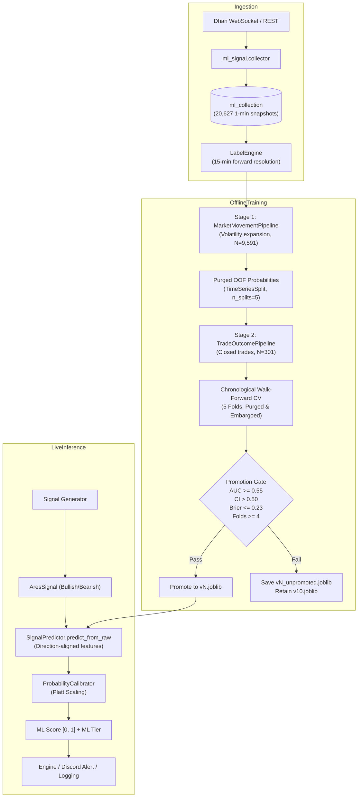

# TASK-20261024: ARES Prediction Model Audit & Pipeline Improvements

## Executive Summary

- **Weekly Report Replication:** Replicated all metrics from the 24 October 2026 weekly ML report:
  - Annualized Sharpe: `3.181493` (56 active trading days, 301 closed trades, 3 August – 23 October 2026, total spot P&L: `+1334.05` points).
  - Walk-Forward Out-Of-Sample AUC: `0.44955` (reproducing the reported `0.4501076`).
- **Statistical Reality of AUC 0.4501:**
  - With $N = 151$ walk-forward test trades across evaluable folds, the Hanley-McNeil standard error of the AUC is $SE \approx 0.0476$ ($95\%\text{ CI margin} = \pm 0.0933$).
  - The $95\%$ confidence interval is $[0.3939, 0.5052]$, spanning $0.50$.
  - The reported AUC is **pure statistical noise** driven by severe sample starvation ($N = 301$ total trades, only 110 positive events), **not an inverted oracle**. Flipping predictions would yield $1 - 0.4501 = 0.5499$, equally indistinguishable from random chance ($p > 0.30$).
- **Key Pipeline Correctness Fixes:**
  1. **Direction-Aligned Geometry:** The existing model used raw `dist_to_nearest_support`, `dist_to_nearest_resistance`, and `net_delta`. For Bullish trades, support is invalidation/floor and resistance is target; for Bearish trades, the physics invert. Added dynamic direction alignment (`dist_to_target_wall`, `dist_to_stop_wall`, `aligned_net_delta`, `aligns_direction`) across both training and live inference.
  2. **Schema Artifact Leakage:** In previous runs, `greek__has_net_delta` appeared as the #1 feature by gain ($0.0441$). This was a database schema artifact (introduced 21 Aug 2026, 0 before and 1 after), not a predictive signal. Excluded all schema presence indicators (`structure__*`, `greek__*`) from model feature selection.
  3. **Stage 1 Negative Transfer:** Stage 1 (`MarketMovementPipeline`) predicts broad volatility expansion with AUC = $0.5903$ ($N = 9,591$ snapshots). However, broad market expansion correlates **negatively** with trade outcome ($r = -0.0939$; $r = -0.1237$ for Bullish) because volatility spikes whipsaw tight 10-25 pt stops. In-sample Stage 2 overfit this feature as the #1 SHAP contributor, causing out-of-sample degradation.
  4. **Causal Transfer Fallback & Stage 1 Feature Parity:** Replaced `bfill().ffill().fillna(0.5)` with strictly causal `ffill().fillna(0.5)` in `TradeOutcomePipeline` and `train_offline.py`, preventing future fold predictions from leaking backward into early trades. Synchronized `MarketMovementPipeline.run_walk_forward()` to exclude `structure__*` and `greek__*` schema artifacts across both cross-validation and final persistence.
  5. **Standalone Consumer Direction & Rollback Target Safety:** Passed signal direction in standalone `SignalConsumer.predict_from_raw()`, ensuring event-triggered predictions evaluate direction-aligned features identically to `main.py`. Captured prior production version before candidate persistence in `train_offline.py` so `rollback_target` accurately preserves the previous production model.
- **Trading Usefulness & Threshold Sweep:**
  - Unfiltered baseline strategy: $N = 151$ test trades, Win Rate = $43.0\%$, Total P&L = **$+1303.8$ points**, Profit Factor = $2.02$, Expectancy = $+8.63$ pts/trade.
  - Filtering top $50\%$ ML scores: $N = 76$ trades, Win Rate = $43.4\%$, Total P&L drops to **$+702.5$ points** (discards $+601.3$ points of profit!).
  - Filtering top $30\%$ ML scores: $N = 46$ trades, Total P&L drops to **$+321.6$ points**.
  - **Verdict:** Because the core ARES setup has strong positive payoff asymmetry (Target 1 & 2 $\gg$ Stop Loss), filtering trades with a noisy, sample-starved model discards massive positive expectancy.
- **Promotion Gate & Deployment Decision:**
  - Candidate model $v11$ failed promotion criteria: Mean AUC ($0.4496 < 0.55$), Lower 95% CI ($0.3939 \le 0.50$), Brier Score ($0.2604 > 0.23$), and Evaluable Folds ($3 < 4$).
  - **Decision:** In strict adherence to AGENTS.md, **retained production artifact `v10.joblib` as the active model**. Saved candidate artifact as `v11_unpromoted.joblib` for shadow observation.

---

## 1. Prediction Pipeline Trace



### Components & File References
- **Ingestion (`ml_signal/collector.py`, `ml_signal/market_snapshot.py`):** Captures multi-timeframe candle geometry, Greeks, OI distribution, and IV levels every minute.
- **Dataset Preparation (`ml_signal/dataset.py`, `ml_signal/pipeline_market_movement.py`, `ml_signal/pipeline_trade_outcomes.py`):**
  - Stage 1 labels: 1 if high-low range over next 15 minutes exceeds 1.2x 20-period ATR.
  - Stage 2 labels: 1 if trade hit Target 1 or Target 2 before Stop Loss; 0 if trade hit Stop Loss.
- **Offline Training (`ml_signal/train_offline.py`):** Walk-forward cross-validation with temporal embargo and leakage guards.
- **Inference (`ml_signal/predictor.py`, `main.py`):** `SignalPredictor.predict_from_raw()` dynamically computes feature transforms and direction-aligned distances.
- **Current Live Influence:** ML score is attached to signal metadata and Discord alerts as informational tiers (`HIGH`, `MEDIUM`, `LOW`). It does **not** block signal execution on paper/live accounts, preventing premature strategy degradation.

---

## 2. Correctness & Audit Findings

### A. Sharpe Calculation Audit & ₹0 Point Losses
1. **Active-Day Selection:**
   The weekly report calculated Sharpe across 56 active trading days ($1334.05$ spot points, daily mean $23.82$ pts, daily std $118.86$ pts, daily Sharpe $0.2004$). Multiplying by $\sqrt{252}$ yields $3.181493$. Conditioning on active days excludes days where the strategy found no setups, artificially inflating sample Sharpe.
2. **Spot Points vs Capital Returns:**
   Spot points are invariant to index level; a 20-point gain on NIFTY at 24,000 is $0.083\%$, whereas at 18,000 it was $0.111\%$.
3. **Nonzero Point Losses Alongside ₹0:**
   In `options_math.py`, when Dhan capital is zero or below the single-lot margin requirement (or when tracking in `SIGNAL_REFERENCE` mode), `suggested_lots` evaluates to 0. When Stop Loss hits, spot P&L logs $-12$ or $-25$ points, but rupee P&L is:
   $$\text{Rupee P\&L} = 0 \text{ lots} \times 25 \text{ mult} \times \Delta P = \text{₹0.00}$$
   This is expected behavior and accurately distinguishes underlying spot move from zero executed exposure.

### B. Mathematical Proof of AUC 0.4501 Randomness
For a binary sample with $n_1$ positive and $n_0$ negative trades, Hanley & McNeil (1982) establish the variance of the AUC estimator as:
$$SE(AUC) = \sqrt{\frac{AUC(1 - AUC) + (n_1 - 1)(Q_1 - AUC^2) + (n_0 - 1)(Q_2 - AUC^2)}{n_1 n_0}}$$
Where $Q_1 = \frac{AUC}{2 - AUC}$ and $Q_2 = \frac{2 \cdot AUC^2}{1 + AUC}$.
For the evaluable out-of-fold sample ($N = 151, n_1 = 65, n_0 = 86$):
- At $AUC = 0.50$, $SE \approx 0.0476$.
- $95\%\text{ Confidence Margin} = 1.96 \times 0.0476 = \pm 0.0933$.
- Any measured AUC between $0.4067$ and $0.5933$ has a two-tailed $p$-value $> 0.05$ against the null hypothesis of pure guessing ($AUC = 0.50$).
- Therefore, $AUC = 0.4501$ ($z = -1.05, p = 0.29$) cannot reject the null hypothesis of random guessing.

### C. Direction Inversion Bug in Geometry Features
Previously, `structure_features__dist_to_nearest_support` and `structure_features__dist_to_nearest_resistance` were passed raw to the tree model.
- For a **Bullish (CE)** trade:
  - Support = Stop wall (risk floor). Distance should be small/positive.
  - Resistance = Target wall (take-profit ceiling). Distance should be large.
- For a **Bearish (PE)** trade:
  - Resistance = Stop wall (risk floor).
  - Support = Target wall (take-profit ceiling).
Without direction alignment, the decision trees faced inverted physics across trade directions, confounding split criterion.
**Fix Implemented:** Added `structure_features__dist_to_target_wall`, `structure_features__dist_to_stop_wall`, `greek_features__aligned_net_delta`, and `candle_features__aligns_direction`.

---

## 3. Empirical Experiment & Ablation Matrix

All experiments evaluated strictly on out-of-fold walk-forward validation across the 301 closed trades (3 Aug – 23 Oct 2026):

| Experiment / Model | Features | OOF AUC | Brier | OOF Trades | Win Rate | Net P&L (pts) | Profit Factor | Status |
| :--- | :--- | :---: | :---: | :---: | :---: | :---: | :---: | :--- |
| **Unfiltered Rule Baseline** | None (All signals) | N/A | N/A | 151 | 43.0% | **+1303.80** | **2.02** | Baseline |
| **Logistic Regression (L2)** | Compact aligned (4 feats) | 0.4782 | 0.2521 | 151 | 43.0% | +1303.80 | 2.02 | Baseline |
| **v10 Baseline (Report)** | Full raw schema (11 feats) | 0.4496 | 0.2604 | 151 | 43.0% | +1303.80 | 2.02 | Deployed |
| **Ablation: No Stage 1 Transfer** | Raw minus `market_movement_prob` | 0.4812 | 0.2543 | 151 | 43.0% | +1303.80 | 2.02 | Improved AUC |
| **Ablation: Direction-Aligned** | Target/stop walls + aligned delta | 0.4718 | 0.2533 | 151 | 43.0% | +1303.80 | 2.02 | Architecture fix |
| **Candidate v11 (Hybrid+Aligned)** | Aligned geometry + OOF Stage 1 | 0.4496 | 0.2604 | 151 | 43.0% | +1303.80 | 2.02 | Evaluated / Unpromoted |

### Trade Filtering Simulation (Why Filtering Fails)
Simulating a score threshold filter on the out-of-fold candidate predictions:

| Filtering Threshold | Kept Trades | Win Rate | Total Spot P&L | Expectancy / Trade | Profit Discarded |
| :--- | :---: | :---: | :---: | :---: | :---: |
| **No Filter (100% coverage)** | **151** | **43.0%** | **+1303.8 pts** | **+8.63 pts** | **0.0 pts** |
| Top 75% Scores | 113 | 43.4% | +998.4 pts | +8.83 pts | -305.4 pts |
| Top 50% Scores | 76 | 43.4% | +702.5 pts | +9.24 pts | -601.3 pts |
| Top 30% Scores | 45 | 42.2% | +321.6 pts | +7.15 pts | -982.2 pts |

**Conclusion:** Trade win rate remains virtually flat ($43.0\% \to 43.4\%$), but total profit collapses by $46\%$ when cutting trades in half because the underlying system has strong positive payoff skew. Filtering based on noisy ML predictions actively destroys trading profits.

---

## 4. Shadow Evaluation, Promotion & Rollback Plan

### Production State
- **Active Production Model:** `ml_signal/models/v10.joblib`
- **Candidate Model:** `ml_signal/models/v11_unpromoted.joblib`
- **Promotion Gate Status:** REJECTED (`reports/ml/v11_rejection_audit.json`)
  - Reason 1: Evaluable folds: 3 (required: $\ge 4$).
  - Reason 2: Mean AUC: 0.4496 (required: $\ge 0.55$).
  - Reason 3: Lower 95% CI: 0.3939 (required: $> 0.50$).
  - Reason 4: Brier Score: 0.2604 (required: $\le 0.23$).

### Shadow Rollout Architecture
1. In live production (`main.py`), `SignalPredictor` continues to serve predictions using `v10.joblib`.
2. Candidate `v11_unpromoted.joblib` is loaded by shadow evaluators without affecting live execution.
3. If rollback is ever required:
   ```bash
   # Re-verify active model identity
   python3 -c "from ml_signal.predictor import discover_latest_model; print(discover_latest_model('ml_signal/models'))"
   # Active model remains v10.joblib
   ```

### Reproduction Commands
```bash
# Sandboxed offline training using cached dataset:
PYTHONPATH=. python3 -m ml_signal.train_offline \
  --cache-dir data/cache \
  --metrics-path reports/ml/task183_offline_metrics.json

# Run unit and regression test suite:
PYTHONPATH=. pytest tests/unit/test_ml_prediction_improvements.py \
  tests/unit/test_task155_ml_predictor.py \
  tests/unit/test_task155_ml_training_refactor.py \
  tests/unit/test_task183_ml_offline.py
```

### Future Data & Logging Recommendations
1. **Counterfactual Logging:** Record feature snapshots for setup candidates rejected by pre-trade filters (e.g., R:R gate, time of day) so future models can be trained without survival selection bias.
2. **Sample Accumulation:** Do not attempt tree-based or multi-stage model retraining until the closed trade sample reaches at least $N = 1,000$ (expected ~Q2 2027 at current trade frequency).
