---
tags:
  - ARES
  - trading
  - post-mortem
  - daily-analysis
date: 2026-10-22
type: daily-observation
---

# ARES Daily Trade Analysis & Post-Mortem — 2026-10-22 (Thursday)

> **Report generated:** 15:28 IST | **Audit window:** 09:15 – 15:28 IST | **System:** ARES Algorithmic Trading Engine

---

## Executive Summary

| Metric | Value |
|--------|-------|
| **Signals Generated (Today)** | 4 (Signals #591, #592, #593, #594) |
| **Trades Executed (Live Broker)** | 0 (Skipped: `INSUFFICIENT_CAPITAL_OR_RISK_BUDGET` — account balance ₹1,180.45) |
| **Reference / Paper Tracked Trades** | 4 (Tracked via newly deployed `SIGNAL_REFERENCE` mode from PR #143) |
| **Reference Spot PnL** | **−60.4 pts** (−25.0, −10.0, −25.0, −0.4) |
| **Actual Executed PnL** | 0.0 pts (₹0.00) |
| **System Status** | Running on Fly.io (`ares-xzy-gq`) |
| **Market** | NIFTY 50 F&O |
| **Mode** | Options (CE/PE) |

**Key Findings:**
1. **Telemetry & Signal Tracking Fully Operational (PR #143 Validation):** Today successfully validated the resolution of yesterday's #1 critical finding (`MANM-281`). Following the merge of PR #143 (`codex/option-alert-visibility`), signals rejected by broker sizing or capital constraints are no longer dropped into a data black hole; all 4 signals were cleanly registered in `active_trades` under `tracking_mode: SIGNAL_REFERENCE` and tracked across `trade_analytics`. Full telemetry integrity has been restored.
2. **First Live In-Market Test of Post-T1 ATR Trailing Stop (PR #143 / MANM-176):** Signal #594 (`TREND_CONTINUATION BEARISH`) delivered the first live execution of the newly introduced Wilder ATR(5) trailing stop module (`atr_trailing.py`). Price moved down from 22,642.20 to hit Target 1 (22,617.20, +25.0 pts gain), immediately ratcheting the stop to break-even. On the ensuing intraday rebound, the runner closed through its active stop at 22,668.0, executing an orderly `ATR_SL_HIT` exit that captured a blended net of **−0.4 pts** and logged outcome score = 1.
3. **Intraday Chop & Directional Oscillation:** Today's session was characterized by violent intraday rangebound chop between 22,620 and 22,740. The engine generated 4 alternating signals within 90 minutes (Bearish $\rightarrow$ Bullish $\rightarrow$ Bullish $\rightarrow$ Bearish), resulting in 3 stop-outs (#591: −25.0 pts, #592: −10.0 pts, #593: −25.0 pts) before Signal #594 captured T1.
4. **Capital Starvation Remains Live Bottleneck:** The Dhan broker account balance sits at ₹1,180.45, preventing live fills on NIFTY option lots requiring ~₹9,750–₹10,500 premium.

```mermaid
flowchart TD
    subgraph S591 ["12:29 IST: Signal #591 (BEAR TREND_CONTINUATION)"]
        A1["Entry: 22,627.05 | SL: 22,652.05 | 22650 PE"] --> B1["Reference Tracking Active"]
        B1 --> C1["12:49 IST: Spot bounces to 22,652.05<br/>❌ SL_HIT (-25.0 pts)"]
    end

    subgraph S592 ["12:55 IST: Signal #592 (BULL EXHAUSTION_REVERSAL)"]
        A2["Entry: 22,730.95 | SL: 22,720.95 (10pt SL) | 22750 CE"] --> B2["Reference Tracking Active"]
        B2 --> C2["12:56 IST: Instant spike to 22,720.95<br/>❌ SL_HIT in 17s (-10.0 pts)"]
    end

    subgraph S593 ["13:16 IST: Signal #593 (BULL TREND_CONTINUATION)"]
        A3["Entry: 22,696.70 | SL: 22,671.70 | 22750 CE"] --> B3["Reference Tracking Active"]
        B3 --> C3["13:19 IST: Immediate rollover to 22,671.70<br/>❌ SL_HIT in 3m (-25.0 pts)"]
    end

    subgraph S594 ["13:58 IST: Signal #594 (BEAR TREND_CONTINUATION)"]
        A4["Entry: 22,642.20 | SL: 22,667.20 | 22700 PE"] --> B4["Reference Tracking Active"]
        B4 --> C4["Spot reaches 22,617.20<br/>🎯 TARGET 1 HIT (+25.0 pts)"]
        C4 --> D4["Stop Trailed to BE (22,642.20)<br/>ATR Trailing Engaged (ATR: 27.8 pts)"]
        D4 --> E4["14:35 IST: 5-min close at 22,668.0<br/>🛡️ ATR_SL_HIT (-0.4 pts net, Score 1)"]
    end
```

---

## Today's Signal Deep Dives

### 1. Signal #591 (Display #4940) — Trend Continuation (Bearish)

| Field | Value |
|-------|-------|
| **Signal ID** | #591 (Display #4940, UUID: `e9101fa0-21b6-4d3d-8e1a-d74c10c00488`) |
| **Setup Type** | `TREND_CONTINUATION` |
| **Direction** | `BEARISH` |
| **Confidence** | `MEDIUM` (Gate suppressed HIGH to MEDIUM: out-of-sample p=1.0000, Δwin=+0.0%) |
| **Timestamp (IST)** | 12:29:00 IST (06:59:00 UTC) |
| **Created At** | 12:30:16 IST (07:00:16 UTC) |
| **Spot at Signal** | 22,627.05 |
| **Trigger Price** | 22,627.05 |
| **Option Contract** | 22650 PE (Delta: −0.4887, IV: 14.37%, Vega: 10.93, Theta: −11.58) |
| **Option Sizing** | Limit: 153.30 \| Option SL: 140.55 \| T1: 164.90 \| T2: 194.60 |
| **Spot Stop Loss** | 22,652.05 (+25.0 pts risk) |
| **Spot Target 1 / Target 2** | T1: 22,602.05 (+25.0 pts) \| T2: 22,547.05 (+80.0 pts) |
| **Execution State** | ❌ **SKIPPED LIVE** (`INSUFFICIENT_CAPITAL_OR_RISK_BUDGET`), ✅ **TRACKED AS REFERENCE** |
| **Exit Outcome** | `SL_HIT` at 22,652.05 @ 12:49:09 IST |
| **Realized PnL** | **−25.0 pts** (Score: 0) |

**Trigger Reasons:**
* Trend continuation: regime held 41 candles before pullback.
* Pullback held 3 candles, resumed at 22,627.05.
* Pullback stayed on the trend side of VWAP — shallow retrace.
* Regime persisted well beyond the minimum arming window.
* Sufficient room to the next opposing structural level.
* Option Sizing status: `INSUFFICIENT_CAPITAL_OR_RISK_BUDGET` (Available capital ₹1,180.45).

---

### 2. Signal #592 (Display #1845) — Exhaustion Reversal (Bullish)

| Field | Value |
|-------|-------|
| **Signal ID** | #592 (Display #1845, UUID: `bb10fd57-24ed-4a97-92b2-78dc5cccc9f6`) |
| **Setup Type** | `EXHAUSTION_REVERSAL` |
| **Direction** | `BULLISH` |
| **Confidence** | `MEDIUM` |
| **Timestamp (IST)** | 12:55:00 IST (07:25:00 UTC) |
| **Created At** | 12:56:18 IST (07:26:18 UTC) |
| **Spot at Signal** | 22,730.95 |
| **Trigger Price** | 22,730.95 |
| **Option Contract** | 22750 CE (Delta: 0.5163, IV: 14.12%, Vega: 10.96, Theta: −17.66) |
| **Option Sizing** | Limit: 161.35 \| Option SL: 156.65 \| T1: 171.25 \| T2: 441.80 |
| **Spot Stop Loss** | 22,720.95 (10.0 pts risk) |
| **Spot Target 1 / Target 2** | T1: 22,748.95 (+18.0 pts) \| T2: 23,120.90 (+389.95 pts) |
| **Execution State** | ❌ **SKIPPED LIVE** (`INSUFFICIENT_CAPITAL_OR_RISK_BUDGET`), ✅ **TRACKED AS REFERENCE** |
| **Exit Outcome** | `SL_HIT` at 22,720.95 @ 12:56:35 IST |
| **Realized PnL** | **−10.0 pts** (Score: 0) — *Stopped out in 17 seconds* |

**Trigger Reasons:**
* Volume climax detected ($2.7\times$ average volume).
* Candle formed a doji-like indecision pattern at 12:55 PM IST.
* Option Sizing status: `INSUFFICIENT_CAPITAL_OR_RISK_BUDGET`.
* *Failure Diagnostic:* Tight 10.0 pt stop was immediately swept by noise in high-volatility conditions where 5-min ATR was ~28 pts.

---

### 3. Signal #593 (Display #9637) — Trend Continuation (Bullish)

| Field | Value |
|-------|-------|
| **Signal ID** | #593 (Display #9637, UUID: `72e79189-8d1d-49c5-9b03-8bfbb8ce43c5`) |
| **Setup Type** | `TREND_CONTINUATION` |
| **Direction** | `BULLISH` |
| **Confidence** | `MEDIUM` |
| **Timestamp (IST)** | 13:16:00 IST (07:46:00 UTC) |
| **Created At** | 13:17:25 IST (07:47:25 UTC) |
| **Spot at Signal** | 22,696.70 |
| **Trigger Price** | 22,696.70 |
| **Option Contract** | 22750 CE (Delta: 0.4843, IV: 13.99%, Vega: 10.93, Theta: −17.32) |
| **Option Sizing** | Limit: 144.05 \| Option SL: 131.40 \| T1: 155.55 \| T2: 441.30 |
| **Spot Stop Loss** | 22,671.70 (+25.0 pts risk) |
| **Spot Target 1 / Target 2** | T1: 22,721.70 (+25.0 pts) \| T2: 23,120.90 (+424.20 pts) |
| **Execution State** | ❌ **SKIPPED LIVE** (`INSUFFICIENT_CAPITAL_OR_RISK_BUDGET`), ✅ **TRACKED AS REFERENCE** |
| **Exit Outcome** | `SL_HIT` at 22,671.70 @ 13:19:31 IST |
| **Realized PnL** | **−25.0 pts** (Score: 0) — *Stopped out in 2 minutes* |

**Trigger Reasons:**
* Trend continuation: regime held 24 candles before pullback.
* Pullback held 3 candles, resumed at 22,696.70.
* Pullback stayed on the trend side of VWAP — shallow retrace.
* Sufficient room to the next opposing structural level.
* Option Sizing status: `INSUFFICIENT_CAPITAL_OR_RISK_BUDGET`.
* *Failure Diagnostic:* Attempted bullish trend continuation in a whipsaw regime following the failed bearish continuation (#591), getting trapped by an immediate rollover.

---

### 4. Signal #594 (Display #1810) — Trend Continuation (Bearish) & ATR Trailing Stop Test

| Field | Value |
|-------|-------|
| **Signal ID** | #594 (Display #1810, UUID: `8ee0baa0-958b-42de-836c-03985db32be9`) |
| **Setup Type** | `TREND_CONTINUATION` |
| **Direction** | `BEARISH` |
| **Confidence** | `MEDIUM` (Gate suppressed HIGH to MEDIUM: out-of-sample p=1.0000, Δwin=+0.0%) |
| **Timestamp (IST)** | 13:58:00 IST (08:28:00 UTC) |
| **Created At** | 13:59:38 IST (08:29:38 UTC) |
| **Spot at Signal** | 22,642.20 |
| **Trigger Price** | 22,642.20 |
| **Option Contract** | 22700 PE (Delta: −0.5245, IV: 13.32%, Vega: 10.86, Theta: −10.36) |
| **Option Sizing** | Limit: 158.20 \| Option SL: 144.60 \| T1: 170.75 \| T2: 202.70 |
| **Spot Stop Loss** | 22,667.20 (+25.0 pts risk) |
| **Spot Target 1 / Target 2** | T1: 22,617.20 (+25.0 pts) \| T2: 22,562.20 (+80.0 pts) |
| **Execution State** | ❌ **SKIPPED LIVE** (`INSUFFICIENT_CAPITAL_OR_RISK_BUDGET`), ✅ **TRACKED AS REFERENCE** |
| **Trailing Telemetry** | ATR: 27.80 pts \| Trailed SL: 22,642.20 (Break-Even) \| Last bar: 14:35:00 IST |
| **Exit Outcome** | `ATR_SL_HIT` on completed 5-min bar close at 22,668.0 @ 14:35:00 IST |
| **Realized PnL** | **−0.4 pts** (Blended: +25.0 on T1 book, −25.8 on runner close $\rightarrow$ Score: 1) |

**Trigger Reasons:**
* Trend continuation: regime held 33 candles before pullback.
* Pullback held 8 candles, resumed at 22,642.20.
* Pullback stayed on the trend side of VWAP — shallow retrace.
* Regime persisted well beyond the minimum arming window.
* Sufficient room to the next opposing structural level.
* Option Sizing status: `INSUFFICIENT_CAPITAL_OR_RISK_BUDGET`.
* *Operational Note:* First trade in system history to exercise the complete post-T1 ATR trailing lifecycle under ADR MANM-176. Target 1 was achieved, stop was moved to BE, and the exit was cleanly cataloged as `ATR_SL_HIT` with positive outcome scoring (`score: 1`).

---

## Performance Dashboard

### Recent Performance (Last 7 Days — Oct 16–22)

| Metric | Value |
|--------|-------|
| Total Trades | 10 |
| Wins | 5 |
| Losses | 5 |
| Break-Even | 0 |
| **Win Rate** | **50.0%** |
| Total PnL | **+40.6 pts** |
| Avg Win | +22.2 pts |
| Avg Loss | −14.1 pts |
| **Risk:Reward** | **1.58:1** |

#### By Setup (7D: Oct 16–22)

| Setup | Count | PnL | Wins | Losses | BE | WR |
|-------|-------|-----|------|--------|----|----|
| **EXHAUSTION_REVERSAL** | 4 | **+16.0** | 2 | 2 | 0 | 50.0% |
| **OI_WALL_REJECTION** | 1 | **+25.0** | 1 | 0 | 0 | 100.0% |
| **TREND_CONTINUATION** | 5 | **−0.4** | 2 | 3 | 0 | 40.0% |

#### By Direction (7D: Oct 16–22)

| Direction | Count | PnL | Wins | Losses | WR |
|-----------|-------|-----|------|--------|----|
| **BULLISH** | 6 | **+30.0** | 3 | 3 | 50.0% |
| **BEARISH** | 4 | **+10.6** | 2 | 2 | 50.0% |

---

### Last 30 Days (Sep 22 – Oct 22)

| Metric | Value |
|--------|-------|
| Total Trades | 101 |
| Wins | 44 |
| Losses | 57 |
| **Win Rate** | **43.6%** |
| Total PnL | **+1,221.7 pts** |
| Avg Win | +46.1 pts |
| Avg Loss | −14.2 pts |
| **Risk:Reward** | **3.26:1** |

#### By Setup (30D)

| Setup | Count | PnL | Wins | Losses | BE | WR |
|-------|-------|-----|------|--------|----|----|
| **TREND_CONTINUATION** | 36 | **+859.8** | 20 | 16 | 0 | **55.6%** |
| **EXHAUSTION_REVERSAL** | 55 | **+334.0** | 21 | 34 | 0 | 38.2% |
| **OI_WALL_REJECTION** | 4 | **+68.0** | 2 | 2 | 0 | 50.0% |
| **FAILED_BREAKOUT** | 6 | **−40.0** | 1 | 5 | 0 | **16.7%** |

#### By Direction (30D)

| Direction | Count | PnL | Wins | Losses | WR |
|-----------|-------|-----|------|--------|----|
| **BEARISH** | 48 | **+791.8** | 24 | 24 | **50.0%** |
| **BULLISH** | 53 | **+430.0** | 20 | 33 | 37.7% |

---

### All-Time Performance (362 Closed Trades)

| Metric | Value |
|--------|-------|
| Total Trades | 362 |
| Wins | 91 |
| Losses | 199 |
| Break-Even (0 pts) | 72 |
| **Win Rate** | **25.1%** |
| Total PnL | **+1,437.5 pts** |
| Avg Win | +48.3 pts |
| Avg Loss | −14.9 pts |
| **Risk:Reward** | **3.25:1** |

#### By Setup (All-Time)

| Setup | Count | PnL | Wins | Losses | BE | WR | % of Total PnL |
|-------|-------|-----|------|--------|----|----|----------------|
| **TREND_CONTINUATION** | 138 | **+1,196.0** | 41 | 55 | 42 | **29.7%** | **83.2%** |
| **EXHAUSTION_REVERSAL** | 177 | **+404.2** | 43 | 112 | 22 | 24.3% | 28.1% |
| **OI_WALL_REJECTION** | 23 | **−59.2** | 4 | 15 | 4 | 17.4% | −4.1% |
| **FAILED_BREAKOUT** | 24 | **−103.5** | 3 | 17 | 4 | **12.5%** | −7.2% |

#### By Direction (All-Time)

| Direction | Count | PnL | Wins | Losses | WR | % of Total PnL |
|-----------|-------|-----|------|--------|----|----------------|
| **BEARISH** | 183 | **+1,195.6** | 50 | 94 | 39 | **27.3%** | **83.2%** |
| **BULLISH** | 179 | **+241.8** | 41 | 105 | 33 | 22.9% | 16.8% |

---

## Root Cause Analysis

### ✅ What Went Right

1. **Telemetry Decoupling Confirmed in Production (PR #143):**
   * Yesterday's report identified that rejected trades left no trace in `trade_analytics`.
   * PR #143 was merged and deployed before market open. Today, when option sizing calculated 0 lots due to broker capital constraints, the engine automatically registered all 4 trades as `SIGNAL_REFERENCE`.
   * Both `active_trades` and `trade_analytics` accurately recorded all life-cycle transitions (entry, SL, trailing ratchet, exit). Zero data loss occurred.
2. **Wilder ATR(5) Trailing Engine Passed First In-Market Test:**
   * Signal #594 validated the end-to-end ATR trailing architecture implemented under ADR MANM-176.
   * Target 1 was achieved, the stop ratcheted to break-even, ATR (27.8 pts) was calculated off completed 5-min bars, and the trade terminated cleanly on a close above the stop level, returning `ATR_SL_HIT` with `score: 1`.
3. **Execution Safety Gate Prevented Broker Margin Deficit:**
   * The live account balance (₹1,180.45) was insufficient for ₹10k options margin. The risk engine correctly refused to place live market orders, preventing account blowout during a choppy session.

### ❌ What Went Wrong / Systemic Failure Modes

1. **Intraday Whipsaw in Rangebound Regime:**
   * NIFTY was locked in a 120-point consolidation zone (22,620 to 22,740).
   * Between 12:29 and 13:58 IST, the engine generated 4 alternating signals. Taking opposing trend continuation trades within 45 minutes in a rangebound market caused back-to-back stop-outs (#591 at −25 pts, #593 at −25 pts).
2. **Sub-Noise Stop Loss on Exhaustion Reversal (#592):**
   * Signal #592 took a 10.0-point stop loss on NIFTY index options.
   * With 5-minute ATR at ~28 points, a 10-point stop is smaller than typical 1-minute candle noise, causing an immediate exit within 17 seconds of signal generation.
3. **Live Capital Starvation (Day 3):**
   * For the third consecutive trading session, live execution was blocked due to an unreplenished account balance (₹1,180.45).

---

## Actionable Algorithmic Recommendations

### 🔴 High Priority (Immediate Action)

| # | Action Item | Description | Expected Impact |
|---|-------------|-------------|-----------------|
| 1 | **Fund Dhan Trading Account** | Deposit a minimum of ₹25,000–₹50,000 into the Dhan live trading account. Current balance (₹1,180.45) cannot cover a single 65-qty NIFTY option lot (~₹10,000). | Restores live automated trade execution. |
| 2 | **Implement Trend Continuation Direction Flip Cooldown** | When a `TREND_CONTINUATION` signal terminates in `SL_HIT`, prohibit taking an opposing `TREND_CONTINUATION` signal for a minimum cooldown period of 45–60 minutes unless a higher-timeframe breakout is confirmed. | Prevents whipsaw stop-outs in rangebound consolidation (such as #591 and #593 today). |
| 3 | **Enforce Dynamic Minimum SL for Exhaustion Reversals** | Replace rigid sub-15 point stop losses with an ATR-proportional minimum: $\text{SL}_{\text{min}} = \max(18.0, 0.75 \times \text{ATR}_{5\text{m}})$. | Eliminates 17-second noise spike stop-outs like Signal #592. |

### 🟡 Medium Priority (Sprint Enhancements)

| # | Action Item | Description | Expected Impact |
|---|-------------|-------------|-----------------|
| 4 | **ATR Trailing Stop Execution Mechanism Review** | Evaluate whether runner stop exits should trigger on intra-bar tick touches of the stop level or remain strictly on completed 5-minute bar closes. (Signal #594 exited at 22,668.0 on bar close vs 22,642.20 stop level). | Reduces slippage on violent reversal candles while maintaining noise immunity. |
| 5 | **Permanently Retire FAILED_BREAKOUT Setup** | All-time performance stands at 12.5% WR and −103.5 pts across 24 trades. Ensure this detector remains completely deprecated. | Protects ~100 points of systemic performance. |
| 6 | **Priority Capital Allocation for Trend Continuation** | All-time data shows `TREND_CONTINUATION` contributes **83.2%** of all net gains (+1,196.0 pts). When capital is restricted, allocate available margin exclusively to Trend Continuation. | Maximizes expected value per unit of deployed capital. |

---

## Open Positions (Options Strategy Module)

| Symbol | Entry Date | Call Strike | Put Strike | IV at Entry | Status |
|--------|-----------|-------------|------------|-------------|--------|
| INDIANB | 2026-09-15 | 940.0 | 780.0 | 47.0% | OPEN |
| CAMS | 2026-09-23 | 790.0 | 660.0 | 52.5% | OPEN |
| ETERNAL | 2026-10-13 | 360.0 | 290.0 | 40.8% | OPEN |
| INDIGO | 2026-10-15 | 5150.0 | 4350.0 | 40.2% | OPEN |

*(Paper trade short strangles in the separate options strategy module).*

---

## Recent Signal Log Summary

| Date | Time (IST) | ID | Setup | Dir | Spot | Strike | Executed | Outcome / Reason |
|------|------------|----|-------|-----|------|--------|----------|-------------------|
| **2026-10-22** | **13:58** | **#594** | **TREND_CONTINUATION** | **BEAR** | **22,642.20** | **22700 PE** | ❌ (Ref: ✅) | **ATR SL Hit (−0.4 pts, T1 hit, Score 1)** |
| **2026-10-22** | **13:16** | **#593** | **TREND_CONTINUATION** | **BULL** | **22,696.70** | **22750 CE** | ❌ (Ref: ✅) | **SL Hit (−25.0 pts, stopped in 2m)** |
| **2026-10-22** | **12:55** | **#592** | **EXHAUSTION_REVERSAL** | **BULL** | **22,730.95** | **22750 CE** | ❌ (Ref: ✅) | **SL Hit (−10.0 pts, stopped in 17s)** |
| **2026-10-22** | **12:29** | **#591** | **TREND_CONTINUATION** | **BEAR** | **22,627.05** | **22650 PE** | ❌ (Ref: ✅) | **SL Hit (−25.0 pts)** |
| 2026-10-21 | 11:40 | #590 | TREND_CONTINUATION | BEAR | 22,822.95 | 22850 PE | ❌ | Skipped (`INSUFFICIENT_OPTION_RR`); T2 hit (+80.0 pts) |
| 2026-10-20 | — | — | — | — | — | — | ⛔ | No signals fired |
| 2026-10-19 | 15:05 | #589 | EXHAUSTION_REVERSAL | BULL | 22,863.50 | 22850 CE | ❌ | Skipped (`NO_AVAILABLE_CAPITAL`) |
| 2026-10-16 | 14:31 | #588 | TREND_CONTINUATION | BULL | 23,092.10 | 23100 CE | ✅ | BE Hit (+25.0 pts) |
| 2026-10-16 | 13:55 | #587 | EXHAUSTION_REVERSAL | BEAR | 23,125.00 | 23150 PE | ✅ | BE Hit (+18.0 pts) |
| 2026-10-16 | 11:53 | #586 | EXHAUSTION_REVERSAL | BULL | 23,114.45 | 23150 CE | ✅ | SL Hit (−10.0 pts) |
| 2026-10-16 | 11:38 | #585 | EXHAUSTION_REVERSAL | BEAR | 23,122.30 | 23150 PE | ✅ | BE Hit (+18.0 pts) |
| 2026-10-16 | 11:20 | #584 | TREND_CONTINUATION | BULL | 23,083.80 | 23100 CE | ✅ | BE Hit (+25.0 pts) |
| 2026-10-16 | 09:22 | #583 | OI_WALL_REJECTION | BULL | 22,966.80 | 23000 CE | ✅ | BE Hit (+25.0 pts) |

---

*Report generated by ARES Debug Agent | Issue MANM-284 | 2026-10-22 15:28 IST*
