---
tags:
  - ARES
  - trading
  - post-mortem
  - daily-analysis
date: 2026-10-26
type: daily-observation
---

# ARES Daily Trade Analysis & Post-Mortem — 2026-10-26 (Monday)

> **Report generated:** 15:28 IST | **Audit window:** 09:15 – 15:28 IST | **System:** ARES Algorithmic Trading Engine

---

## Executive Summary

| Metric | Value |
|--------|-------|
| **Signals Generated (Today)** | 5 (Signals #598, #599, #600, #601, #602) |
| **Trades Executed (Live Broker)** | 0 (Skipped: `INSUFFICIENT_CAPITAL_OR_RISK_BUDGET` — account balance ₹1,180.45) |
| **Reference / Paper Tracked Trades** | 5 (Tracked via `SIGNAL_REFERENCE` mode under PR #143) |
| **Closed Reference Spot PnL** | **−61.0 pts** (−12.0, −12.0, −12.0, −25.0 across 4 closed trades) |
| **Open / In-Progress Reference Runner** | **+76.2 pts** blended locked gain on #601 (T1: +25.0 pts, Trailed SL at **22,707.52**, +127.4 pts above entry) |
| **Net Reference PnL (Blended with Trailed Runner)** | **+15.2 pts** |
| **Actual Executed PnL** | 0.0 pts (₹0.00) |
| **System Status** | Running on Fly.io (`ares-xzy-gq`, stopped at session close 15:30 IST) |
| **Market** | NIFTY 50 F&O |
| **Mode** | Options (CE/PE) |

**Key Findings:**
1. **FAILED_BREAKOUT Re-Emergence and Severe Drag:** Despite explicit deprecation recommendations on 2026-10-22 due to all-time negative EV (−103.5 pts, 12.5% WR), `FAILED_BREAKOUT` remained active in `engine.py` as the top-priority detector. In today's volatile morning session, it fired three consecutive times (#598, #599, #600) and suffered three immediate stop-outs (−12.0, −12.0, −12.0 = **−36.0 pts**). In the last 30 days, `FAILED_BREAKOUT` has an abysmal **0% win rate (0 for 8, −96.0 pts)**, dragging all-time performance down to **−139.6 pts (11.1% WR)**.
2. **Wilder ATR(5) Trailing Stop Delivers Massive Trailed Gain on Signal #601:** Signal #601 (`TREND_CONTINUATION BULLISH`) triggered at 22,580.10. Price smoothly surged to hit Target 1 (22,605.10, +25.0 pts), ratcheting the stop to break-even. As NIFTY continued its trend upward, the ATR trailing engine (`atr_trailing.py`, ATR: 18.27 pts) continuously trailed the protective stop across completed 5-minute bars all the way to **22,707.52** (+127.42 pts above entry) into market close at 15:30 IST without touching the stop. This locked in a blended gain of **+76.21 pts** on the setup.
3. **Risk Budget Round-Down Starvation on Sizing (#601):** Signal #601 was sized down to 0 lots (`suggested_lots: 0`) despite the account holding synthetic capital of ₹15,645.64. The 4% risk budget was ₹625.82, while a single 65-quantity lot with 10.45 pt risk required ₹679.25 in risk budget. The minute deficit of **₹53.43 (0.34% of capital)** forced integer truncation to 0 lots, preventing this trade from passing validation even in a funded test environment.
4. **Pyramiding / Redundant Re-Entry Stop-Out (#602):** At 14:12 IST, with Signal #601 already deep in profit (+126 pts) and riding its trailed stop, the engine triggered Signal #602 (`TREND_CONTINUATION BULLISH`) at 22,706.15—the very peak of the day's move after 64 candles of trend extension. A routine 25-point retracement immediately knocked out #602 at 22,681.15 (−25.0 pts) before consolidating into close, highlighting the lack of open-trade position awareness in `engine.py`.
5. **Broker Account Starvation Continues (Day 4):** Live account balance remained at ₹1,180.45, preventing live execution across all validly sized trades (#598, #599, #600, #602).

```mermaid
flowchart TD
    subgraph S598 ["09:18 IST: Signal #598 (BEAR FAILED_BREAKOUT)"]
        A1["Entry: 22,446.80 | SL: 22,458.80 (12pt SL) | 22450 PE"] --> B1["Reference Tracking Active"]
        B1 --> C1["09:19 IST: Immediate wick bounce to 22,458.80<br/>❌ SL_HIT in 60s (-12.0 pts)"]
    end

    subgraph S599 ["09:26 IST: Signal #599 (BULL FAILED_BREAKOUT)"]
        A2["Entry: 22,418.20 | SL: 22,406.20 (12pt SL) | 22400 CE"] --> B2["Reference Tracking Active"]
        B2 --> C2["09:27 IST: Dip to fresh low 22,406.20<br/>❌ SL_HIT in 103s (-12.0 pts)"]
    end

    subgraph S600 ["10:04 IST: Signal #600 (BEAR FAILED_BREAKOUT)"]
        A3["Entry: 22,636.30 | SL: 22,648.30 (12pt SL) | 22650 PE"] --> B3["Reference Tracking Active"]
        B3 --> C3["10:06 IST: Bullish momentum pierces 22,648.30<br/>❌ SL_HIT in 2m (-12.0 pts)"]
    end

    subgraph S601 ["12:51 IST: Signal #601 (BULL TREND_CONTINUATION)"]
        A4["Entry: 22,580.10 | Initial SL: 22,555.10 | 22600 CE"] --> B4["Reference Tracking Active (0 lots sized)"]
        B4 --> C4["Spot reaches 22,605.10<br/>🎯 TARGET 1 HIT (+25.0 pts)"]
        C4 --> D4["Stop Ratcheted to BE (22,580.10)<br/>ATR Trailing Engaged (ATR: 18.27 pts)"]
        D4 --> E4["Stop Trailed to 22,686.64 → 22,707.52<br/>🛡️ 15:30 IST Close: Holds +127.42 pts on Runner<br/>(Blended locked gain: +76.21 pts)"]
    end

    subgraph S602 ["14:12 IST: Signal #602 (BULL TREND_CONTINUATION)"]
        A5["Entry: 22,706.15 (Top of move) | SL: 22,681.15 | 22700 CE"] --> B5["Fired while #601 active"]
        B5 --> C5["14:16 IST: 25pt pullback to 22,681.15<br/>❌ SL_HIT in 4m (-25.0 pts)"]
    end
```

---

## Today's Signal Deep Dives

### 1. Signal #598 (Display #7599) — Failed Breakout (Bearish)

| Field | Value |
|-------|-------|
| **Signal ID** | #598 (Display #7599, UUID: `8339b52e-6497-417f-8ffa-9ce0e6f0bd86`) |
| **Setup Type** | `FAILED_BREAKOUT` |
| **Direction** | `BEARISH` |
| **Confidence** | `MEDIUM` |
| **Timestamp (IST)** | 09:18:00 IST (03:48:00 UTC) |
| **Created At** | 09:19:27 IST (03:49:27 UTC) |
| **Spot at Signal** | 22,446.80 |
| **Trigger Price** | 22,446.80 |
| **Option Contract** | 22450 PE (Delta: −0.4913, IV: 20.12%, Vega: 5.73, Theta: −35.51) |
| **Option Sizing** | Limit: 113.00 \| Option SL: 105.15 \| T1: 120.90 \| T2: 151.05 |
| **Spot Stop Loss** | 22,458.80 (+12.0 pts risk) |
| **Spot Target 1 / Target 2** | T1: 22,426.80 (+20.0 pts) \| T2: 22,372.00 (+74.8 pts) |
| **Execution State** | ❌ **SKIPPED LIVE** (`INSUFFICIENT_CAPITAL_OR_RISK_BUDGET`), ✅ **TRACKED AS REFERENCE** |
| **Exit Outcome** | `SL_HIT` at 22,458.80 @ 09:19:00 IST |
| **Realized PnL** | **−12.0 pts** (Score: 0) — *Stopped out in 60 seconds* |

**Trigger Reasons:**
* Price closed back past level 22500.0.
* Option writers did not cover their positions.
* Option writers actively defended and added positions ($\ge 10.0\%$ OI growth).
* Price closed back deeply past level ($\ge 5.0$ points).
* Option Sizing status: `VALID` (1 lot, Limit 113.00).
* *Failure Diagnostic:* High-volatility opening bar noise immediately swept through the tight 12-point stop within 60 seconds.

---

### 2. Signal #599 (Display #1504) — Failed Breakout (Bullish)

| Field | Value |
|-------|-------|
| **Signal ID** | #599 (Display #1504, UUID: `1f79d10a-0c85-443c-b2ae-14ac618a1be0`) |
| **Setup Type** | `FAILED_BREAKOUT` |
| **Direction** | `BULLISH` |
| **Confidence** | `MEDIUM` |
| **Timestamp (IST)** | 09:26:00 IST (03:56:00 UTC) |
| **Created At** | 09:27:31 IST (03:57:31 UTC) |
| **Spot at Signal** | 22,418.20 |
| **Trigger Price** | 22,418.20 |
| **Option Contract** | 22400 CE (Delta: 0.5219, IV: 27.86%, Vega: 5.70, Theta: −56.52) |
| **Option Sizing** | Limit: 168.40 \| Option SL: 166.75 \| T1: 183.90 \| T2: 190.45 |
| **Spot Stop Loss** | 22,406.20 (+12.0 pts risk) |
| **Spot Target 1 / Target 2** | T1: 22,438.20 (+20.0 pts) \| T2: 22,450.00 (+31.8 pts) |
| **Execution State** | ❌ **SKIPPED LIVE** (`INSUFFICIENT_CAPITAL_OR_RISK_BUDGET`), ✅ **TRACKED AS REFERENCE** |
| **Exit Outcome** | `SL_HIT` at 22,406.20 @ 09:27:43 IST |
| **Realized PnL** | **−12.0 pts** (Score: 0) — *Stopped out in 103 seconds* |

**Trigger Reasons:**
* Price closed back past level 22400.0.
* Breakout candle volume was weak.
* Option writers did not cover their positions.
* Price closed back deeply past level ($\ge 5.0$ points).
* Option Sizing status: `VALID` (1 lot, Limit 168.40).
* *Failure Diagnostic:* Whipsaw reversal attempt fired 7 minutes after #598 stopped out. Spot flushed to a lower low at 22,406.20 before setting a session base.

---

### 3. Signal #600 (Display #2759) — Failed Breakout (Bearish)

| Field | Value |
|-------|-------|
| **Signal ID** | #600 (Display #2759, UUID: `962d2f8e-a4b0-4699-84ce-c768ab7dfd11`) |
| **Setup Type** | `FAILED_BREAKOUT` |
| **Direction** | `BEARISH` |
| **Confidence** | `MEDIUM` |
| **Timestamp (IST)** | 10:04:00 IST (04:34:00 UTC) |
| **Created At** | 10:05:44 IST (04:35:44 UTC) |
| **Spot at Signal** | 22,636.30 |
| **Trigger Price** | 22,636.30 |
| **Option Contract** | 22650 PE (Delta: −0.4802, IV: 20.30%, Vega: 5.61, Theta: −35.63) |
| **Option Sizing** | Limit: 100.90 \| Option SL: 92.15 \| T1: 108.55 \| T2: 289.75 |
| **Spot Stop Loss** | 22,648.30 (+12.0 pts risk) |
| **Spot Target 1 / Target 2** | T1: 22,616.30 (+20.0 pts) \| T2: 22,372.00 (+264.3 pts) |
| **Execution State** | ❌ **SKIPPED LIVE** (`INSUFFICIENT_CAPITAL_OR_RISK_BUDGET`), ✅ **TRACKED AS REFERENCE** |
| **Exit Outcome** | `SL_HIT` at 22,648.30 @ 10:06:23 IST |
| **Realized PnL** | **−12.0 pts** (Score: 0) — *Stopped out in 2 minutes* |

**Trigger Reasons:**
* Price closed back past level 22650.0.
* IV is dropping rapidly (IV Crush).
* Option writers did not cover their positions.
* Price closed back deeply past level ($\ge 5.0$ points).
* Option Sizing status: `VALID` (1 lot, Limit 100.90).
* *Failure Diagnostic:* Attempted counter-trend shorting into a roaring 230-point recovery rally from 22,400 to 22,640. Strong trend momentum effortlessly blew through the 12-point stop.

---

### 4. Signal #601 (Display #4585) — Trend Continuation (Bullish) & ATR Trailing Stop Masterclass

| Field | Value |
|-------|-------|
| **Signal ID** | #601 (Display #4585, UUID: `2a7e9ef6-ae58-41f1-97d6-e3afba2f40a8`) |
| **Setup Type** | `TREND_CONTINUATION` |
| **Direction** | `BULLISH` |
| **Confidence** | `MEDIUM` (Gate suppressed HIGH to MEDIUM: out-of-sample $p=1.0000$, $\Delta\text{win}=+0.0\%$) |
| **Timestamp (IST)** | 12:51:00 IST (07:21:00 UTC) |
| **Created At** | 12:52:28 IST (07:22:28 UTC) |
| **Spot at Signal** | 22,580.10 |
| **Trigger Price** | 22,580.10 |
| **Option Contract** | 22600 CE (Delta: 0.4842, IV: 23.28%, Vega: 5.46, Theta: −50.22) |
| **Option Sizing** | Limit: 120.20 \| Option SL: 109.95 \| T1: 134.40 \| T2: 249.85 (0 lots: risk budget deficit ₹53.43) |
| **Spot Stop Loss** | 22,555.10 (+25.0 pts initial risk) |
| **Spot Target 1 / Target 2** | T1: 22,605.10 (+25.0 pts) \| T2: 22,787.25 (+207.15 pts) |
| **Execution State** | ❌ **SKIPPED LIVE** (`INSUFFICIENT_CAPITAL_OR_RISK_BUDGET`), ✅ **TRACKED AS REFERENCE** |
| **Trailing Telemetry** | ATR: 18.27 pts \| Stop ratcheted to BE at 22,580.10 $\rightarrow$ trailed to 22,686.64 $\rightarrow$ **22,707.52** at close |
| **Exit Outcome** | **RUNNER SURVIVED TO SESSION CLOSE** (State: `T1_HIT`, protective stop locked at 22,707.52) |
| **Realized / Locked PnL** | **+76.2 pts blended** (T1 booked +25.0 pts; runner protective stop locked at +127.42 pts) |

**Trigger Reasons:**
* Trend continuation: regime held 59 candles before pullback.
* Pullback held 3 candle(s), resumed at 22,580.10.
* Pullback stayed on the trend side of VWAP — shallow retrace.
* Regime persisted well beyond the minimum arming window.
* Sufficient room to the next opposing structural level.
* Option Sizing status: `INSUFFICIENT_CAPITAL_OR_RISK_BUDGET` (4% budget = ₹625.82 vs ₹679.25 lot risk).
* *Operational Note:* Exemplary execution of trend continuation logic and Wilder ATR(5) trailing ratchet. After booking Target 1 (+25.0 pts), the runner stop was moved to BE and continuously elevated as NIFTY trended 130+ points higher, reaching 22,707.52 at the 15:30 IST close without triggering an exit.

---

### 5. Signal #602 (Display #0777) — Trend Continuation (Bullish) — Redundant Re-Entry

| Field | Value |
|-------|-------|
| **Signal ID** | #602 (Display #0777, UUID: `e2793b0b-7b20-4d17-b86b-fcb0f27c6d50`) |
| **Setup Type** | `TREND_CONTINUATION` |
| **Direction** | `BULLISH` |
| **Confidence** | `MEDIUM` (Gate suppressed HIGH to MEDIUM: out-of-sample $p=1.0000$, $\Delta\text{win}=+0.0\%$) |
| **Timestamp (IST)** | 14:12:00 IST (08:42:00 UTC) |
| **Created At** | 14:13:59 IST (08:43:59 UTC) |
| **Spot at Signal** | 22,706.15 |
| **Trigger Price** | 22,706.15 |
| **Option Contract** | 22700 CE (Delta: 0.5152, IV: 25.42%, Vega: 5.38, Theta: −56.19) |
| **Option Sizing** | Limit: 142.30 \| Option SL: 131.55 \| T1: 157.55 \| T2: 190.15 |
| **Spot Stop Loss** | 22,681.15 (+25.0 pts risk) |
| **Spot Target 1 / Target 2** | T1: 22,731.15 (+25.0 pts) \| T2: 22,787.25 (+81.1 pts) |
| **Execution State** | ❌ **SKIPPED LIVE** (`INSUFFICIENT_CAPITAL_OR_RISK_BUDGET`), ✅ **TRACKED AS REFERENCE** |
| **Exit Outcome** | `SL_HIT` at 22,681.15 @ 14:16:00 IST |
| **Realized PnL** | **−25.0 pts** (Score: 0) — *Stopped out in 4 minutes* |

**Trigger Reasons:**
* Trend continuation: regime held 64 candles before pullback.
* Pullback held 4 candle(s), resumed at 22,706.15.
* Pullback stayed on the trend side of VWAP — shallow retrace.
* Regime persisted well beyond the minimum arming window.
* Sufficient room to the next opposing structural level.
* Option Sizing status: `VALID` (1 lot, Limit 142.30).
* *Failure Diagnostic:* Signal fired at the literal session high (22,706.15) while Signal #601 was already open and riding the trend. A normal, shallow 25-point retracement tagged the stop at 22,681.15 before price stabilized into the close.

---

## Performance Dashboard

### Recent Performance (Last 7 Days — Oct 20–26)

| Metric | Value |
|--------|-------|
| Total Trades | 11 |
| Wins | 1 |
| Losses | 10 |
| **Win Rate** | **9.1%** |
| Total PnL | **−139.2 pts** |
| Avg Win | +32.1 pts |
| Avg Loss | −17.1 pts |
| **Risk:Reward** | **1.88:1** |

#### By Setup

| Setup | Count | PnL | Wins | Losses | BE | WR |
|-------|-------|-----|------|--------|----|----|
| **EXHAUSTION_REVERSAL** | 1 | **−10.0** | 0 | 1 | 0 | **0.0%** |
| **FAILED_BREAKOUT** | 3 | **−36.0** | 0 | 3 | 0 | **0.0%** |
| **TREND_CONTINUATION** | 7 | **−93.2** | 1 | 6 | 0 | **14.3%** |

#### By Direction

| Direction | Count | PnL | Wins | Losses | WR |
|-----------|-------|-----|------|--------|----|
| **BEARISH** | 7 | **−67.2** | 1 | 6 | **14.3%** |
| **BULLISH** | 4 | **−72.0** | 0 | 4 | **0.0%** |

---

### Last 30 Days (Sep 26 – Oct 26)

| Metric | Value |
|--------|-------|
| Total Trades | 82 |
| Wins | 32 |
| Losses | 50 |
| **Win Rate** | **39.0%** |
| Total PnL | **+444.7 pts** |
| Avg Win | +37.1 pts |
| Avg Loss | −14.9 pts |
| **Risk:Reward** | **2.50:1** |

#### By Setup

| Setup | Count | PnL | Wins | Losses | BE | WR |
|-------|-------|-----|------|--------|----|----|
| **EXHAUSTION_REVERSAL** | 41 | **+296.0** | 17 | 24 | 0 | **41.5%** |
| **FAILED_BREAKOUT** | 8 | **−96.0** | 0 | 8 | 0 | **0.0%** |
| **OI_WALL_REJECTION** | 4 | **+68.0** | 2 | 2 | 0 | **50.0%** |
| **TREND_CONTINUATION** | 29 | **+176.8** | 13 | 16 | 0 | **44.8%** |

#### By Direction

| Direction | Count | PnL | Wins | Losses | WR |
|-----------|-------|-----|------|--------|----|
| **BEARISH** | 37 | **+116.8** | 14 | 23 | **37.8%** |
| **BULLISH** | 45 | **+328.0** | 18 | 27 | **40.0%** |

---

### All-Time Performance (370 Closed Trades)

| Metric | Value |
|--------|-------|
| Total Trades | 370 |
| Wins | 92 |
| Losses | 206 |
| Break-Even (0 pts) | 72 |
| **Win Rate** | **24.9%** |
| Total PnL | **+1,342.6 pts** |
| Avg Win | +48.2 pts |
| Avg Loss | −15.0 pts |
| **Risk:Reward** | **3.21:1** |

#### By Setup (All-Time)

| Setup | Count | PnL | Wins | Losses | BE | WR | % of Total PnL |
|-------|-------|-----|------|--------|----|----|----------------|
| **TREND_CONTINUATION** | 142 | **+1,153.2** | 42 | 58 | 42 | **29.6%** | **85.9%** |
| **EXHAUSTION_REVERSAL** | 177 | **+404.2** | 43 | 112 | 22 | **24.3%** | **30.1%** |
| **OI_WALL_REJECTION** | 24 | **−75.2** | 4 | 16 | 4 | **16.7%** | **−5.6%** |
| **FAILED_BREAKOUT** | 27 | **−139.6** | 3 | 20 | 4 | **11.1%** | **−10.4%** |

#### By Direction (All-Time)

| Direction | Count | PnL | Wins | Losses | WR | % of Total PnL |
|-----------|-------|-----|------|--------|----|----------------|
| **BEARISH** | 189 | **+1,137.8** | 51 | 99 | **27.0%** | **84.7%** |
| **BULLISH** | 181 | **+204.8** | 41 | 107 | **22.7%** | **15.3%** |

---

## Root Cause Analysis

### ✅ What Went Right

1. **ATR Trailing Engine Locked In Major Outperformance (#601):**
   * Signal #601 demonstrated the complete potential of the Wilder ATR(5) trailing ratchet (`atr_trailing.py`).
   * By ratcheting the stop above entry to 22,686.64 and finally to 22,707.52 (+127.42 pts above entry), the engine protected massive intraday gains while giving the runner ample room to breathe through 20-point pullbacks.
2. **Zero Telemetry Loss via Reference Tracking:**
   * All 5 signals were accurately registered in `active_trades` and `trade_analytics` regardless of whether lots were 0 or broker execution was blocked.
   * State transitions (`T1_HIT`, `SL_HIT`, ATR trailing updates) were persisted cleanly.
3. **Account Protection Against Sizing Deficit:**
   * Live broker orders remained safely gated with balance at ₹1,180.45, avoiding broker margin rejections and overdraft fees.

### ❌ What Went Wrong / Systemic Failure Modes

1. **Failure to Deprecate FAILED_BREAKOUT Detector:**
   * Despite clear findings in previous post-mortems, `FAILED_BREAKOUT` remained priority #1 in `engine.py`.
   * It generated 3 false signals within 50 minutes during choppy morning action, bleeding **−36.0 pts**.
   * Last 30 days: **0% win rate across 8 trades (−96.0 pts)**. All-time: **−139.6 pts**.
2. **Rigid Risk Sizing Ceiling Starvation (#601):**
   * Signal #601—the highest-yielding trade of the month—was assigned 0 lots due to a trivial ₹53.43 (0.34%) budget threshold breach (allowed risk ₹625.82 vs 1-lot risk ₹679.25).
   * Integer truncation with no flexible floor ($<5\%$ tolerance) prevented execution of the day's best setup.
3. **Blind Multi-Position Generation Without Position Context (#602):**
   * At 14:12 IST, while Signal #601 was actively in `T1_HIT` with an open runner, the engine fired another bullish trend continuation trade (#602) at the highest candle of the day.
   * Taking a second trade in the exact same direction at the climax of an extended trend resulted in an immediate 25-point stop-out on normal mean reversion.

---

## Actionable Algorithmic Recommendations

### 🔴 High Priority (Immediate Action)

| # | Action Item | Description | Expected Impact |
|---|-------------|-------------|-----------------|
| 1 | **Disable `FAILED_BREAKOUT` in `engine.py`** | Remove `FAILED_BREAKOUT` from active evaluation in `engine.tick()` and `config.py` detector lists. Comment out or flag-gate to `False`. | Immediately stops a systemic drain that has lost −96.0 pts in the last 30 days and −139.6 pts all-time. |
| 2 | **Implement Minimum 1-Lot Discretionary Buffer in Option Sizing** | In `options_math.py`, if `affordable_lots >= 1` and the risk dollar amount exceeds `risk_budget` by less than 15% (e.g. risk up to 4.6% instead of strict 4.0%), permit 1 lot rather than truncating to 0. | Eliminates trivial starvation on trades like #601 (which fell short by only ₹53). |
| 3 | **Implement Active-Position Guard (No Duplicate Directional Entries)** | In `engine.tick()`, inspect `position_manager.active_trades`. If an active trade already exists in the same direction (`BULLISH` or `BEARISH`), suppress secondary continuation entries unless explicitly flagged for pyramiding. | Prevents buying the top of the move and stop-outs like Signal #602 (−25.0 pts). |
| 4 | **Fund Dhan Trading Account** | Deposit ₹25,000–₹50,000 into the Dhan live broker account. | Restores live execution capabilities. |

### 🟡 Medium Priority (Sprint Enhancements)

| # | Action Item | Description | Expected Impact |
|---|-------------|-------------|-----------------|
| 5 | **EOD Square-Off Hook for Trailed Runners** | Ensure that when market reaches 15:30 IST, active trades in `T1_HIT` have their final exit logged with `exit_type: EOD_CLOSE`, `exit_price: last_close`, and finalized `pnl_points` written to `trade_analytics`. | Ensures clean accounting of open runners upon market close. |
| 6 | **Regime Age Ceiling for Trend Continuation** | Cap `regime_held_candles` for new trend continuation entries to $\le 50$ candles. When regime has lasted $>60$ candles (as in #602: 64 candles), the risk of mean reversion sharply increases. | Avoids climax exhaustion traps on trend setups. |

---

## Open Positions (Options Strategy Module)

| Symbol | Entry Date | Call Strike | Put Strike | Status |
|--------|-----------|-------------|------------|--------|
| INDIANB | 2026-09-15 | 940.0 | 780.0 | OPEN |
| CAMS | 2026-09-23 | 790.0 | 660.0 | OPEN |
| ETERNAL | 2026-10-13 | 360.0 | 290.0 | OPEN |
| INDIGO | 2026-10-15 | 5150.0 | 4350.0 | OPEN |

*(Paper trade short strangles in the separate options strategy module).*

---

## Recent Signal Log Summary

| Date | Time (IST) | ID | Setup | Dir | Spot | Strike | Executed | Outcome / Reason |
|------|------------|----|-------|-----|------|--------|----------|-------------------|
| **2026-10-26** | **14:12** | **#602** | **TREND_CONTINUATION** | **BULL** | **22,706.15** | **22700 CE** | ❌ (Ref: ✅) | **SL Hit (−25.0 pts, stopped in 4m)** |
| **2026-10-26** | **12:51** | **#601** | **TREND_CONTINUATION** | **BULL** | **22,580.10** | **22600 CE** | ❌ (Ref: ✅) | **T1 Hit (+25.0 pts), Stop Trailed to 22,707.52 (+127.4 pts locked)** |
| **2026-10-26** | **10:04** | **#600** | **FAILED_BREAKOUT** | **BEAR** | **22,636.30** | **22650 PE** | ❌ (Ref: ✅) | **SL Hit (−12.0 pts, stopped in 2m)** |
| **2026-10-26** | **09:26** | **#599** | **FAILED_BREAKOUT** | **BULL** | **22,418.20** | **22400 CE** | ❌ (Ref: ✅) | **SL Hit (−12.0 pts, stopped in 103s)** |
| **2026-10-26** | **09:18** | **#598** | **FAILED_BREAKOUT** | **BEAR** | **22,446.80** | **22450 PE** | ❌ (Ref: ✅) | **SL Hit (−12.0 pts, stopped in 60s)** |
| 2026-10-23 | 15:03 | #597 | TREND_CONTINUATION | BEAR | 22,496.05 | 22500 PE | ❌ (Ref: ✅) | SL Hit (−25.0 pts) |
| 2026-10-23 | 11:05 | #596 | TREND_CONTINUATION | BEAR | 22,434.80 | 22500 PE | ❌ (Ref: ✅) | SL Hit (−25.0 pts) |
| 2026-10-23 | 10:08 | #595 | TREND_CONTINUATION | BEAR | 22,552.10 | 22550 PE | ❌ (Ref: ✅) | ATR SL Hit (+32.15 pts) |
| 2026-10-22 | 13:58 | #594 | TREND_CONTINUATION | BEAR | 22,642.20 | 22700 PE | ❌ (Ref: ✅) | ATR SL Hit (−0.4 pts, T1 hit, Score 1) |
| 2026-10-22 | 13:16 | #593 | TREND_CONTINUATION | BULL | 22,696.70 | 22750 CE | ❌ (Ref: ✅) | SL Hit (−25.0 pts, stopped in 2m) |
| 2026-10-22 | 12:55 | #592 | EXHAUSTION_REVERSAL | BULL | 22,730.95 | 22750 CE | ❌ (Ref: ✅) | SL Hit (−10.0 pts, stopped in 17s) |
| 2026-10-22 | 12:29 | #591 | TREND_CONTINUATION | BEAR | 22,627.05 | 22650 PE | ❌ (Ref: ✅) | SL Hit (−25.0 pts) |
| 2026-10-21 | 11:40 | #590 | TREND_CONTINUATION | BEAR | 22,822.95 | 22850 PE | ❌ | Skipped (`INSUFFICIENT_OPTION_RR`); T2 hit (+80.0 pts) |
| 2026-10-20 | — | — | — | — | — | — | ⛔ | No signals fired |
| 2026-10-19 | 15:05 | #589 | EXHAUSTION_REVERSAL | BULL | 22,863.50 | 22850 CE | ❌ | Skipped (`NO_AVAILABLE_CAPITAL`) |
| 2026-10-16 | 14:31 | #588 | TREND_CONTINUATION | BULL | 23,092.10 | 23100 CE | ✅ | BE Hit (+25.0 pts) |
| 2026-10-16 | 13:55 | #587 | EXHAUSTION_REVERSAL | BEAR | 23,125.00 | 23150 PE | ✅ | BE Hit (+18.0 pts) |
| 2026-10-16 | 11:53 | #586 | EXHAUSTION_REVERSAL | BULL | 23,114.45 | 23150 CE | ✅ | SL Hit (−10.0 pts) |
| 2026-10-16 | 11:38 | #585 | EXHAUSTION_REVERSAL | BEAR | 23,122.30 | 23150 PE | ✅ | BE Hit (+18.0 pts) |
| 2026-10-16 | 11:20 | #584 | TREND_CONTINUATION | BULL | 23,083.80 | 23100 CE | ✅ | BE Hit (+25.0 pts) |
| 2026-10-16 | 09:22 | #583 | OI_WALL_REJECTION | BULL | 22,966.80 | 23000 CE | ✅ | BE Hit (+25.0 pts) |

---

*Report generated by ARES Debug Agent | Issue MANM-303 | 2026-10-26 15:28 IST*
