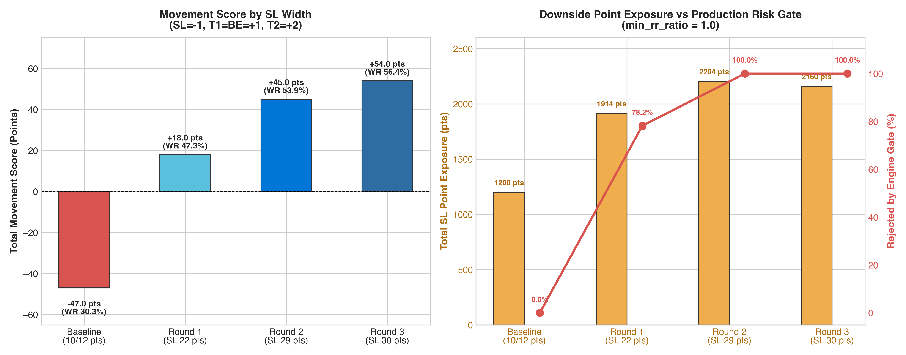
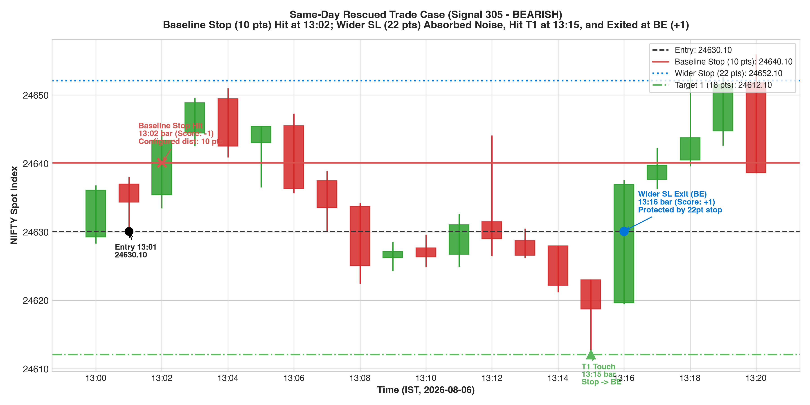
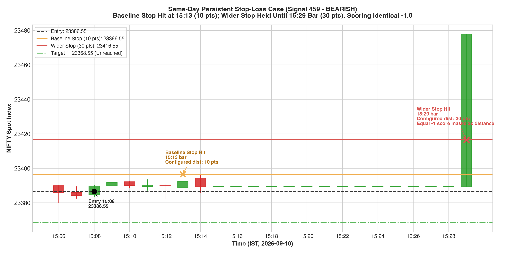

# Exhaustion reversal — three wider stops

**Wider stops improved your movement score in this historical replay.** The 30-point stop produced the highest score; it also allowed three times the adverse movement of today's 10-point stop. This supports further testing, rather than an immediate live change.

Antigravity implemented the experiments. Codex independently checked all 660 primary trade scores and exit bars against the previously verified scorer. No production code, live settings, orders or database records were changed.

## Results

165 recorded entries from Supabase were replayed against 59 complete Dhan NIFTY one-minute sessions, July 20–October 12, 2026. Each trade kept its original entry reference and targets. These are index-point stop distances, not option-premium stops.

Scoring: initial SL = **−1**; T1 then break-even = **+1**; T2 = **+2 total**. No lots or cash accounting.

| Stop distance | T1 without T2* | T2 | Initial SL | Total score | Original SL trades rescued |
|---|---:|---:|---:|---:|---:|
| Original 10 / 12 | 32 | 18 | 115 | **−47** | — |
| 22 | 51 | 27 | 87 | **+18** | 28 |
| 29 | 57 | 32 | 76 | **+45** | 39 |
| 30 | 60 | 33 | 72 | **+54** | 43 |

*One trade in every setting reached T1 but remained unfinished at the October 12 data cutoff. Its earned +1 is included; the other T1-only outcomes ended at break-even. No primary trade was pending before T1. The primary replay permits holding across sessions; separate end-of-day results retain unfinished trades.

On the later September–October portion alone, the original score was **−28**, compared with **+7 / +22 / +24** for stops **22 / 29 / 30**. The improvement therefore also appears after the period used to select the widths. This later period had been inspected in earlier research; it is historical validation, not an untouched test set.

## Why these three widths?

Of 82 July–August entries, eight moved beyond their original stop but subsequently reached T1 within 30 minutes. Their adverse excursions were 13.30, 13.60, 18.65, 19.40, 20.85, 29.25, 29.50 and 40.65 points.

The predeclared median / 75th / 90th percentile rule, rounded upward with a one-point buffer and capped at 30, produced 22 / 30 / 30. The duplicate was replaced with its nearest unused width, 29, giving **22 / 29 / 30**. Thus 29 and 30 are neighbouring sensitivity checks, not two independently established optimal stops. Eight recovery examples are a weak basis for choosing a permanent setting.

## What improved, and what still needs care?

- Some entries were right about the eventual direction but needed more room: the 30-point stop converted 43 baseline losses into T1 or T2 outcomes.
- 72 trades still stopped out at 30 points. Your score correctly records each as −1, but the allowed adverse distance is larger.
- As a separate distance diagnostic, summing configured stops on SL outcomes increases from **1,200** to **1,914 / 2,204 / 2,160** index points. This is neither cash P&L nor realized loss; gaps can cross a stop.
- ARES currently requires T1 distance to be at least the stop distance. With targets unchanged, **129/165** entries fail that rule at SL 22; **all 165** fail at SL 29 or 30. All 83 recent validation entries have T1 18 and fail each wider-stop setting. These experiments therefore cannot be deployed unchanged under the current rule.

With fixed entries and targets, widening a stop while assigning every loss the same −1 makes the movement score mechanically non-worsening. The meaningful finding is how many trades recover, at what extra distance, and whether that survives realistic execution and future observations—not simply that the total score rises.

## Next decision

**Keep wider stops as a research candidate. Do not switch the live system directly to 30.** First run a prospective shadow comparison and decide explicitly whether to retain the current T1-to-stop rule. A modest stop capped at the current T1 distance is another future experiment; it has not been tested in these three rounds. Changing targets would require a separate replay.

This is a fixed-recorded-entry study. Longer holding can change cooldowns and later live entries. One-minute candles also omit the first partial entry minute and cannot establish intrabar order. Signal 475 even has a recorded stop before the first full replay minute; it remains included and flagged. Conservative ordering and alternate entry-price checks reduce, but cannot eliminate, these limitations.

See [full report](REPORT.md), [frozen selection](selection.json), [trade ledger](all_variants_ledger.csv), and [independent verification](review_verification.json).

